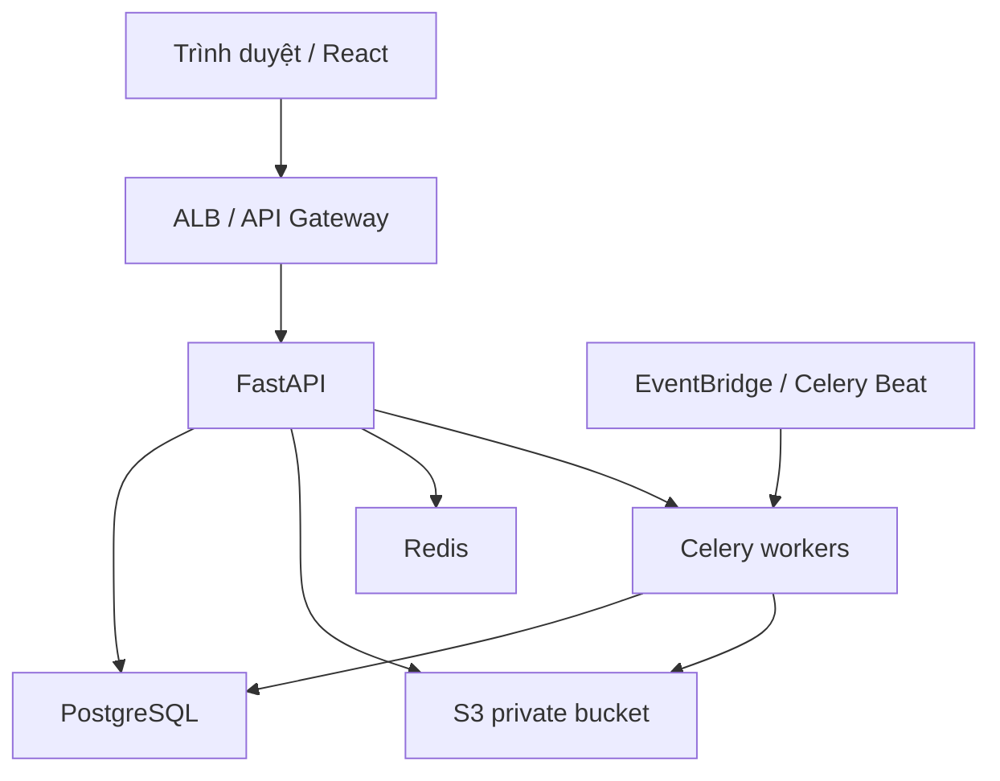
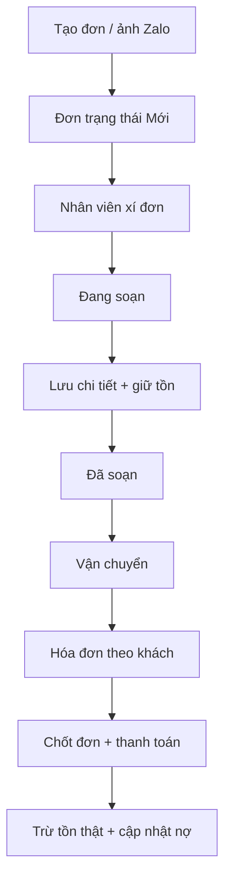
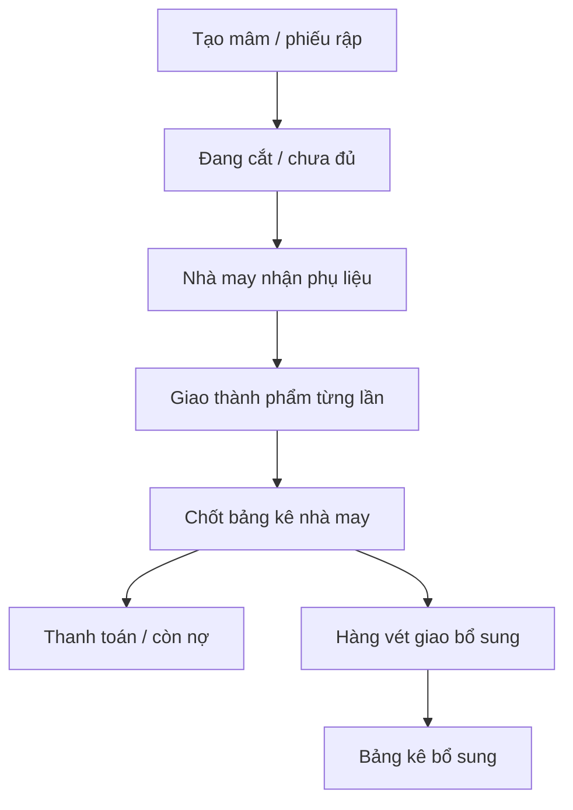

# AZALAS SPORT — TECHNICAL CONTEXT & SPECIFICATION

> Tài liệu ngữ cảnh kỹ thuật cho việc tái cấu trúc Google Apps Script + Google Sheets/Drive thành React + FastAPI + PostgreSQL + AWS S3.

## 0. Kiểm soát tài liệu

| Thuộc tính | Giá trị |
|---|---|
| Phiên bản | 1.0 — Migration baseline |
| Ngày chốt khảo sát | 08/10/2026 |
| Nguồn khảo sát | Source Apps Script hiện tại; `Index.html`; `HangVetNhaMay.gs`; `Rap_GiaoPhuLieu.gs`; manifest; toàn bộ thư mục Drive `WebApp` và tiêu đề các bảng dữ liệu |
| Target stack | React + TypeScript; FastAPI + Python; PostgreSQL; AWS S3 |
| Mục tiêu tương thích | Giữ nguyên 100% giao diện, hành vi và luồng thao tác mà người dùng đang thấy; chỉ thay nền tảng kỹ thuật |
| Đối tượng đọc | TPM, Solution Architect, Backend/Frontend/Data/QA/DevOps engineer và AI Coding Assistant |
| Múi giờ nghiệp vụ | `Asia/Ho_Chi_Minh` (tương đương UTC+7; dữ liệu cũ đang dùng `GMT+7`/`Asia/Bangkok`) |
| Ngôn ngữ nghiệp vụ | Tiếng Việt |

### 0.1 Nguyên tắc bắt buộc

1. Không thay đổi UI/UX, nhãn tiếng Việt, thứ tự thao tác, cách chia kho hoặc cách người dùng xử lý đơn nếu chưa có yêu cầu nghiệp vụ mới được phê duyệt.
2. Không dùng tên khách hàng, tên nhà may hoặc tên nhân viên làm khóa liên kết. Luôn dùng UUID/ID; tên chỉ là dữ liệu hiển thị.
3. Mọi nghiệp vụ thay đổi tồn kho, công nợ, thanh toán, chốt đơn và chốt nhà may phải chạy trong một transaction PostgreSQL, có khóa phù hợp và có idempotency key.
4. Không lưu URL S3 có chữ ký trong database. Chỉ lưu `bucket`, `object_key`, `version_id`, metadata; URL ký tạm được tạo khi đọc.
5. Không xóa vật lý chứng từ tài chính/kho đã phát sinh. Sử dụng trạng thái hủy, bút toán đảo và audit log bất biến.
6. Không lưu mật khẩu dạng rõ. Dữ liệu tài khoản cũ phải chuyển sang Argon2id/bcrypt và buộc đổi mật khẩu khi đăng nhập lần đầu sau migration.
7. Mọi số tiền phải có quy ước đơn vị rõ ràng. Dữ liệu hiện tại có chỗ nhập giá theo “nghìn đồng”; ETL phải chuẩn hóa thành VND nguyên (`BIGINT`) và kiểm tra đối soát trước cutover.
8. Ngày người dùng nhìn thấy luôn là `dd/MM/yyyy`; API truyền ISO-8601; server không được suy diễn chuỗi `09/12/2026` theo định dạng Mỹ.

### 0.2 Phạm vi source đã đọc

- `Code.gs`: khoảng 21.500 dòng, hơn 500 hàm, hơn 100 action kiểu `data.type`.
- `Index.html`: khoảng 57.600 dòng, 34 screen và các modal/component nội tuyến.
- `HangVetNhaMay.gs`: nghiệp vụ hàng vét sau khi bảng kê nhà may đã chốt.
- `Rap_GiaoPhuLieu.gs`: lịch sử giao dây kéo/phụ liệu theo từng mâm.
- `appsscript.json`: V8, web app chạy bằng tài khoản triển khai, truy cập anonymous.
- 8 spreadsheet nghiệp vụ và các thư mục ảnh/tài liệu trong Drive `WebApp`.

Không phát hiện `DocumentApp` hoặc Google Docs template trong source/thư mục gốc. “Tài liệu” hiện tại chủ yếu là ảnh hóa đơn dựng từ HTML, ảnh Zalo, ảnh sản phẩm/rập, phiếu nhập xưởng dạng ảnh và PDF phụ liệu.

### 0.3 Cấu trúc kiến trúc mục tiêu



Khuyến nghị triển khai:

- Frontend: React 18+, TypeScript, Vite, React Router, TanStack Query, React Hook Form + Zod, CSS Modules/Tailwind chỉ khi có thể sao chép chính xác giao diện hiện tại.
- Backend: FastAPI, Pydantic v2, SQLAlchemy 2, Alembic, psycopg3, boto3, structlog, OpenTelemetry.
- Data: PostgreSQL 16+, Redis cho cache/queue/khóa ngắn hạn, S3 private có versioning và lifecycle.
- Jobs: Celery worker + Celery Beat hoặc AWS EventBridge Scheduler; không chạy việc nặng trong request web.
- Observability: CloudWatch hoặc OpenTelemetry collector, Sentry, health/readiness endpoints, audit logs nghiệp vụ.

---

# Phần 1 — Tổng quan nghiệp vụ và luồng dữ liệu

## 1.1 Mục đích ứng dụng

AZALAS SPORT là hệ thống quản trị vận hành xưởng may và bán hàng, giải quyết một chuỗi nghiệp vụ liên thông:

- Nhận yêu cầu đặt hàng từ ảnh Zalo hoặc từ kế hoạch rập.
- Gom và soạn nhiều đơn của cùng khách nhưng vẫn chia theo kho xuất.
- Giữ tồn khi soạn; trừ tồn thật khi chốt hóa đơn; hoàn giữ/hoàn tồn khi hủy.
- Quản lý vận chuyển, hóa đơn, thu tiền, hàng trả và công nợ khách.
- Theo dõi rập/mâm, nhà may, thợ cắt, nhận hàng, hàng vét, giao phụ liệu, chốt công và thanh toán.
- Quản lý kho thành phẩm, biến thể, chuyển kho, kiểm kê, phiếu nhập/xuất và truy vết thẻ kho.
- Quản lý phụ liệu/mua hàng: dây kéo, thêu, in nhãn, vải và công nợ đối tác.
- Quản lý nhân sự, chấm công, ứng lương, lương tháng.
- Cung cấp dashboard, báo cáo, cảnh báo dữ liệu và nhật ký thao tác.

## 1.2 Nhóm người dùng và phân quyền

| Role hiện tại | Ý nghĩa | Phạm vi mục tiêu |
|---|---|---|
| `OWNER` | Chủ hệ thống | Toàn quyền; duyệt thao tác nhạy cảm; xem thống kê người soạn và quản trị tổng |
| `ADMIN` | Quản lý toàn quyền | Quản lý vận hành; không được sửa/xóa OWNER; chỉ OWNER được sửa/xóa ADMIN đã tồn tại |
| `MEMBER` | Nhân viên cơ bản | Quyền tối thiểu theo ma trận màn hình |
| `BAN_HANG` | Bán hàng | Tạo đơn, khách hàng, vận chuyển, xem tồn khả dụng |
| `KHO` | Kho | Tồn, nhập/xuất, giữ hàng, chuyển kho, khách trả, kiểm kê, cảnh báo |
| `RAP` | Rập/xưởng | QL Rập, nhà may, thợ cắt, nhận hàng, phụ liệu, đối soát |
| `KE_TOAN` | Kế toán/công nợ | Hóa đơn, công nợ, thu/chi, thanh toán, báo cáo tiền |
| `NHAN_SU` | Nhân sự | Nhân viên, chấm công, ứng lương, lương tháng |
| `BAO_CAO` | Báo cáo | Chỉ đọc báo cáo tổng hợp |

Hệ thống đích dùng RBAC chuẩn hóa: `users`, `roles`, `permissions`, `user_roles`, `role_permissions`. Mọi API tự kiểm quyền; ẩn nút phía React không được xem là biện pháp bảo mật.

## 1.3 Các bounded context

1. Identity & Access.
2. Sales/CRM.
3. Order Fulfillment & Shipping.
4. Billing, Payments & Debt.
5. Returns.
6. Finished Goods Inventory.
7. Pattern/Cutting/Workshop Production (`QL Rập`).
8. Materials & Procurement.
9. Human Resources.
10. Reporting, Audit & Media.

## 1.4 Luồng tổng thể từ tạo đơn đến chốt công nợ



### 1.4.1 Tạo đơn bán hàng

1. Người dùng chọn ngày tạo, ngày giao, loại/kho đơn: Tân Xuân, Cá Koi, Tân Xuân và Cá Koi hoặc Khách đặt.
2. Chọn/tạo khách, tải ảnh Zalo, nhập ghi chú.
3. Server tạo `MaHoaDon`; chống request lặp bằng idempotency key và unique constraint.
4. Nếu loại “Tân Xuân và Cá Koi”, tạo hai order con có cùng `order_group_id`, một order cho mỗi kho. Không gộp tồn giữa hai kho.
5. Ảnh được upload S3 và liên kết với order; order bắt đầu ở `NEW`.
6. Có thể tạo một lô cho nhiều khách qua `POST /api/v1/orders/bulk`. Mỗi khách là một dòng độc lập, có ghi chú/ảnh riêng; ghi chú chung được ghép vào ghi chú từng khách. Endpoint kiểm tra toàn bộ khách và media trước khi tạo, ghi status event/audit cho từng order và commit toàn lô một lần. Khi chọn cả hai kho, mỗi khách có group riêng với hai order con; ảnh cùng dòng được liên kết cho hai order con mà không sao chép tệp. `Idempotency-Key` bắt buộc và được phân biệt theo dòng khách để replay cùng request không tạo đơn trùng.

### 1.4.2 Danh sách “Chi tiết đơn” và gom theo khách

- Danh sách trước tiên chia theo kho.
- Trong từng kho, gom theo `customer_id`, không gom theo chuỗi tên.
- Một khách có nhiều order ở các thời điểm khác nhau chỉ hiện một thẻ khách trong kho đó.
- Nhấn tên khách mở một trang soạn liên tục chứa toàn bộ order đủ điều kiện của khách trong kho đang chọn; người soạn có thể hoàn thành lần lượt mà không phải thoát về danh sách.
- Các tab giữ nguyên: Đơn mới, Đang soạn, Nợ đơn, Khách đặt và tab Thống kê chỉ OWNER.

### 1.4.3 Xí đơn, soạn và giữ tồn

1. Khi nhân viên nhấn nhận/xí đơn, server khóa row order và chỉ cho phép nếu chưa có người khác nhận.
2. Nếu đã được người khác nhận, trả `409 ORDER_ALREADY_CLAIMED` cùng tên người đang soạn.
3. Khi lưu chi tiết, bỏ các dòng không có tên hoặc số lượng `<= 0`.
4. Xóa/đảo reservation cũ của chính order, kiểm tra khả dụng, tạo reservation mới.
5. `available = on_hand - reserved`; lưu soạn chỉ tăng `reserved`, chưa giảm `on_hand`.
6. Lưu chi tiết mới, đánh dấu `PICKED`, ghi `picked_at`, người soạn và audit diff; đặt `billing_status = READY` để đơn xuất hiện ở Hóa đơn / Chưa gửi đơn. Chưa tạo/chốt hóa đơn.
7. Form phải giữ nguyên trạng thái khi người dùng tick/nhập số; chỉ đóng hoặc reload sau khi API lưu thành công.

### 1.4.4 Vận chuyển

- Cập nhật trạng thái vận chuyển và ghi một sự kiện lịch sử cho mỗi lần đổi.
- Trạng thái xử lý đơn và trạng thái hóa đơn là hai trục độc lập; không ghi “Đã gửi đơn” đè lên trạng thái soạn/vận chuyển.
- Mọi chuyển trạng thái phải qua state machine, không nhận chuỗi trạng thái tự do từ client.

### 1.4.5 Hóa đơn, thanh toán và công nợ

1. Màn Hóa đơn gom các order hợp lệ của cùng khách; có thể chốt nhiều order cùng lúc.
2. Tổng tiền ưu tiên bản chi tiết đã sửa còn hiệu lực; nếu không có thì dùng chi tiết gốc.
3. Người dùng nhập một hoặc nhiều dòng thanh toán/hàng trả/cộng thêm.
4. Trong một transaction:
   - Khóa customer, order, reservation và inventory balance liên quan.
   - Kiểm tồn lần cuối.
   - Chuyển reservation thành xuất thật: giảm `on_hand`, giảm `reserved`, ghi stock ledger.
   - Đặt invoice/order billing status thành `SENT/CLOSED`.
   - Ghi payment, payment allocation, debt ledger và cập nhật balance.
   - Nếu dùng hàng trả để cấn trừ, đánh dấu phiếu trả đã duyệt và liên kết chứng từ.
5. Công thức tương thích:
   - `invoice_balance = order_total + surcharge - received_payment`.
   - `customer_debt_after = debt_before + order_total + surcharge - received_payment - approved_return_credit`.
6. Chênh lệch làm tròn `<= 1 VND` có thể quy về 0; quy tắc này phải cấu hình, không hard-code ở nhiều nơi.

### 1.4.6 Xóa/hủy/khôi phục order

- Soft delete order chưa xuất: trả reservation, đổi trạng thái, giữ toàn bộ lịch sử.
- Hủy order đã xuất: tạo stock reversal cộng lại tồn, không sửa/xóa ledger cũ.
- Khôi phục chỉ áp dụng order soft-deleted chưa xuất; phải kiểm lại tồn để giữ hàng. Nếu thiếu tồn, trả lỗi và yêu cầu soạn lại.
- Permanent delete chỉ dành cho dữ liệu test/chưa phát sinh nghiệp vụ và OWNER; production mặc định cấm.

### 1.4.7 Hàng trả

1. Tạo phiếu trả gồm khách, order gốc nếu có, kho nhập lại, tình trạng và các dòng hàng.
2. Phiếu mới ở `NEW`; duyệt sẽ nhập lại tồn nếu tình trạng cho phép, tạo stock ledger và/hoặc credit công nợ.
3. Một phiếu chỉ được duyệt/cấn trừ một lần; dùng unique constraint và idempotency key.
4. Sửa phiếu phải lưu revision/audit; không ghi đè mất dấu dữ liệu cũ.

## 1.5 Luồng QL Rập / sản xuất



### 1.5.1 Tạo mâm

- Hai chế độ: khách đặt và hàng xưởng.
- Bắt buộc: ngày cắt, nhà may, mã rập, size, tỷ lệ, số lớp, tên sản phẩm, thợ cắt.
- Đơn khách đặt bắt buộc ngày giao; đồng thời tạo order bán hàng kênh `RAP` và liên kết hai chiều.
- Tổng kế hoạch được tính từ biểu thức số lớp hiện tại (`20x5=100`, `10+20+30`, hoặc số đơn). Target nên lưu cả chuỗi gốc và số đã parse; parser phải có test riêng.
- Trạng thái khởi tạo: sản xuất `CUTTING_INCOMPLETE`, nhận hàng `NOT_RECEIVED`, thanh toán `UNPAID`.

### 1.5.2 Giao phụ liệu cho mâm

- Mỗi lần giao là một event bất biến; không ghi đè phiếu trước và hiện tại không tự trừ tồn phụ liệu.
- Danh mục mặc định: Dây kéo, Dây luồn, Thun, Sợi bún, Nút chân, Thêu, Đục lỗ, In, Phụ liệu khác; bổ sung tên từ danh mục vật tư.
- Mỗi dòng có `total_required`, tổng đã giao, giao đủ phần còn thiếu hoặc giao một phần.
- Không cho tổng cần nhỏ hơn tổng đã giao; mỗi request tối đa 100 dòng; không trùng tên trong cùng request.
- `clientToken`/`Idempotency-Key` chống lưu hai lần.

### 1.5.3 Chốt và thanh toán nhà may

- Chỉ mâm đúng nhà may, chưa có bảng kê, số đã giao > 0 và đơn giá > 0 mới được chốt.
- Một bảng kê có nhiều mâm; tổng công = tổng `quantity_delivered * unit_price`.
- Thanh toán phân bổ theo bảng kê còn nợ; phần trả dư/chưa phân bổ vẫn phải ghi thành khoản credit/unallocated, không được mất lịch sử.
- Công nợ hiện tại phải dựng từ ledger chi tiết, không lấy một con số chỉnh tay làm nguồn sự thật.

### 1.5.4 Hàng vét sau khi đã chốt

- Nút giao diện là **“Thêm dòng”** cạnh “Copy bảng”.
- Chỉ chọn mâm đã có bảng kê gốc của đúng nhà may.
- Nhập ngày, số lượng nguyên dương, đơn giá dương, ghi chú; request có idempotency key.
- Không sửa bảng kê gốc hoặc các khoản thanh toán cũ.
- Phiếu hàng vét cập nhật số đã nhận của mâm và tạo một bảng kê bổ sung riêng; liên kết `original_settlement_id`.
- Trạng thái tương thích: `WRITING -> WAITING_SETTLEMENT -> SETTLING -> SETTLED`.
- Nếu số lượng/thành tiền mâm thay đổi đồng thời, transaction phải fail và đưa phiếu sang `RECONCILIATION_REQUIRED`; tuyệt đối không cập nhật nửa chừng.

## 1.6 Kho thành phẩm

- Hàng hóa → biến thể theo mã rập/hiệu/màu/size → tồn theo kho/vị trí.
- Mọi nhập, xuất, chuyển, trả hàng, kiểm kê, điều chỉnh và hoàn tồn đều tạo stock ledger.
- `inventory_balances` là số tổng hợp tối ưu đọc; `inventory_transactions` là nguồn đối soát bất biến.
- Chuyển kho phải trừ nguồn và cộng đích trong cùng transaction.
- Điều chỉnh tồn cần yêu cầu và duyệt; người tạo không mặc nhiên là người duyệt nếu cấu hình separation-of-duties bật.
- Không cho `on_hand < 0`, `reserved < 0` hoặc `reserved > on_hand`, trừ khi OWNER bật chế độ nhập liệu lịch sử có kiểm soát.

## 1.7 Phụ liệu/mua hàng, nhân sự và báo cáo

- Dây kéo, thêu, in nhãn và vải đều có danh mục/đối tác, giao dịch phát sinh, ứng trước/thanh toán và công nợ.
- Nhật In và Tùng In là hai sổ hiện tại nhưng target dùng chung mô hình `partners` + `partner_transactions`, phân biệt bằng partner/category.
- Nhân sự gồm hồ sơ, chấm công, ứng lương, bảng lương theo tháng.
- Dashboard/cache là read model; không được là nguồn sự thật.
- Thống kê người soạn chỉ OWNER: theo tháng và kho; “Đã soạn” dùng `picked_at`, “Đang soạn” dùng `updated_at`, kèm danh sách order.

## 1.8 Quy tắc nghiệp vụ chuẩn hóa

| ID | Quy tắc |
|---|---|
| BR-AUTH-001 | Tài khoản không ACTIVE bị từ chối đăng nhập. |
| BR-AUTH-002 | OWNER không thể bị tạo/sửa/xóa qua API thường; chỉ quy trình đặc quyền có MFA. |
| BR-AUTH-003 | ADMIN không được sửa/xóa OWNER; chỉ OWNER được sửa/xóa ADMIN hiện hữu. |
| BR-ORD-001 | `order_no` unique; request tạo lặp trả kết quả cũ thay vì tạo bản ghi mới. |
| BR-ORD-002 | Đơn hai kho tạo hai order con nhưng chung `order_group_id`. |
| BR-ORD-003 | Nhóm danh sách bằng `(warehouse_id, customer_id)`. |
| BR-ORD-004 | Hai nhân viên không thể cùng xí một order. |
| BR-ORD-005 | Không chuyển PICKED nếu không có ít nhất một dòng hợp lệ. |
| BR-INV-001 | Lưu soạn chỉ reserve; chốt hóa đơn mới xuất thật. |
| BR-INV-002 | Hủy trước chốt trả reserve; hủy sau chốt tạo reversal. |
| BR-INV-003 | Mọi thay đổi tồn phải có ledger và reference document. |
| BR-DEBT-001 | Nợ được tính từ ledger; bảng tổng hợp chỉ là projection/cache. |
| BR-DEBT-002 | Payment được phân bổ nhiều chứng từ; phần dư lưu unallocated credit. |
| BR-RET-001 | Phiếu trả chỉ duyệt/cấn trừ một lần. |
| BR-RAP-001 | Mâm khách đặt bắt buộc ngày giao và order đồng bộ. |
| BR-RAP-002 | Bảng kê gốc đã chốt không được sửa bởi luồng hàng vét. |
| BR-RAP-003 | Hàng vét tạo bảng kê bổ sung có liên kết bảng kê gốc. |
| BR-RAP-004 | Giao phụ liệu là event append-only; tổng giao không vượt tổng cần. |
| BR-DATE-001 | Chuỗi ngày UI được parse rõ `dd/MM/yyyy`; API dùng ISO-8601. |
| BR-FILE-001 | File private; chỉ cấp presigned URL ngắn hạn cho người có quyền. |
| BR-AUDIT-001 | Mọi mutate API ghi actor, before/after, request ID và entity reference. |

---

# Phần 2 — Chuyển Google Apps Script/Drive sang FastAPI và S3

## 2.1 Ánh xạ dịch vụ nền tảng

| Hiện tại | Mục đích | Thay thế mục tiêu |
|---|---|---|
| `SpreadsheetApp` | Database dạng bảng | PostgreSQL + SQLAlchemy/Alembic |
| `DriveApp` | Lưu ảnh/PDF | S3 private + metadata PostgreSQL |
| `HtmlService` + `Index.html` | SPA/server HTML | React SPA triển khai CDN/CloudFront |
| `google.script.run`/`doPost data.type` | RPC tự chế | REST JSON `/api/v1/...` |
| `LockService` | Chống ghi đồng thời | PostgreSQL transaction, row lock, advisory lock khi cần |
| `CacheService` | Cache dashboard 30 giây | Redis TTL/read model/materialized view |
| `PropertiesService` | Folder/config | Environment/Secrets Manager + bảng `app_settings` |
| `ScriptApp.getOAuthToken` | Xuất file Google | IAM role + S3/renderer service |
| `GmailApp` | Gửi backup | SES/SNS; backup thật bằng RDS snapshot/pg_dump vào S3 |
| Time trigger thủ công | Sao lưu định kỳ | EventBridge Scheduler/Celery Beat |

## 2.2 Document generation

### 2.2.1 Hiện trạng xác nhận

- Không có `DocumentApp` và không tìm thấy Google Docs template trong folder gốc.
- Hóa đơn hiện được render bằng HTML/CSS trong `Index.html`, chụp thành PNG/JPEG và lưu theo thư mục khách hàng.
- Phiếu nhập rập, ảnh Zalo, ảnh sản phẩm/rập là ảnh; hồ sơ phụ liệu có PDF tải lên.

### 2.2.2 Thiết kế mục tiêu

1. Tách layout hóa đơn/phiếu thành template Jinja2 versioned trong repository.
2. Backend lấy một snapshot bất biến của order, item, payment và debt tại thời điểm generate.
3. Render HTML bằng Jinja2; dùng font tiếng Việt đóng gói trong image/container.
4. Nếu cần PDF: WeasyPrint render PDF/A hoặc PDF tiêu chuẩn; nếu chỉ cần ảnh giống UI, Playwright/Chromium chụp template ở viewport cố định.
5. Tính SHA-256, upload S3, ghi `generated_documents` và `media_objects`.
6. Trả document metadata và presigned URL thời hạn 5–15 phút.
7. Không tạo lại tài liệu cũ khi template đổi; lưu `template_version` và payload snapshot.

`docxtpl` chỉ dùng khi người dùng thực sự cần `.docx` chỉnh sửa. Không dùng `python-docx` để mô phỏng hóa đơn pixel-perfect nếu HTML/CSS đang là nguồn giao diện chuẩn.

### 2.2.3 API generation đề xuất

`POST /api/v1/documents/generate` nhận `document_type`, `entity_id`, `format`, `template_version`, `idempotency_key`; trả `202` và job ID. Worker render/upload; React poll hoặc nhận SSE/WebSocket. Tài liệu nhỏ có thể render đồng bộ nhưng vẫn phải có timeout và idempotency.

## 2.3 Thiết kế S3

Một bucket private theo môi trường, ví dụ `azalas-prod-private`, bật versioning, SSE-KMS, block public access và lifecycle:

| Prefix | Nội dung |
|---|---|
| `zalo-order-images/{order_id}/` | Ảnh khách gửi |
| `product-images/{product_id}/{variant_id}/` | Ảnh sản phẩm/màu |
| `invoice-images/{customer_id}/{invoice_id}/` | Ảnh/PDF hóa đơn |
| `workshop-receipts/{production_receipt_id}/` | Phiếu nhập xưởng |
| `material-files/{partner_id}/{transaction_id}/` | PDF/ảnh phụ liệu |
| `rap-images/{pattern_note_id}/` | Ảnh/nội dung mã rập |
| `exports/{yyyy}/{mm}/` | Báo cáo xuất |
| `backups/{yyyy}/{mm}/{dd}/` | Backup mã hóa, retention dài hạn |

Upload flow:

1. React gọi `POST /media/presign-upload` với tên, MIME, size, SHA-256 dự kiến và entity scope.
2. Backend kiểm quyền, whitelist MIME (`image/jpeg`, `image/png`, `application/pdf`), giới hạn size và cấp presigned POST.
3. React upload trực tiếp S3.
4. React gọi complete; backend `HEAD` object, kiểm size/MIME/hash, ghi metadata và enqueue antivirus/image-processing.
5. Chỉ object trạng thái `READY` mới được hiển thị.

Không dùng ACL `ANYONE_WITH_LINK`. Tạo thumbnail bằng worker và CloudFront signed URL nếu tải nhiều.

## 2.4 Triggers và automation

Source không chứa `onEdit`, `onOpen` hoặc code tự tạo trigger. Có hàm `backupDataToEmail()` được ghi chú là backup mỗi đêm, nên nhiều khả năng trigger được cấu hình thủ công ngoài source. Migration phải kiểm tra danh sách trigger trong Apps Script Console trước cutover.

| Job | Trigger mục tiêu | Xử lý |
|---|---|---|
| Backup PostgreSQL | EventBridge mỗi đêm | RDS automated snapshot + `pg_dump` mã hóa vào S3; kiểm restore định kỳ |
| Báo cáo/cache ngày | Celery Beat 5–15 phút hoặc event-driven | Refresh materialized views/read models |
| Đối soát tồn và công nợ | Mỗi đêm | So ledger với balance/projection; tạo alert, không tự sửa im lặng |
| Dọn upload dang dở | Hàng giờ | Xóa object `PENDING` quá TTL |
| Tạo thumbnails | Event S3/Celery | Resize ảnh, giữ bản gốc |
| Render PDF/ảnh hóa đơn | Theo event | Worker nhận outbox event sau commit |
| Nhắc đơn trễ/hàng thiếu | Hàng ngày | Query deadline và phát notification |

Mọi event sau transaction dùng transactional outbox; worker xử lý at-least-once và bắt buộc idempotent.

---

# Phần 3 — Thiết kế PostgreSQL

## 3.1 Quy ước chung

- PK: `uuid` dùng UUIDv7; mã hiển thị (`order_no`, `receipt_no`) vẫn giữ format hiện tại và unique.
- Thời gian: `timestamptz`, lưu UTC; render theo `Asia/Ho_Chi_Minh`.
- Ngày thuần: `date`.
- Tiền VND: `bigint`, không dùng float. Tên cột có hậu tố `_amount`.
- Số lượng: `numeric(18,3)`; các nghiệp vụ bắt buộc nguyên có CHECK `quantity = trunc(quantity)`.
- Mọi bảng mutable có `created_at`, `updated_at`, `created_by`, `updated_by`, `version integer` để optimistic locking.
- Soft delete: `deleted_at`, `deleted_by`; chứng từ đã post dùng status/reversal, không soft delete tùy tiện.
- Chuỗi tìm kiếm tên có `unaccent` + trigram index; vẫn giữ nguyên Unicode để hiển thị.
- JSONB chỉ dành cho snapshot/payload mở rộng, không thay thế quan hệ cốt lõi.

## 3.2 Enum chính

```sql
user_status        = ACTIVE | LOCKED | DISABLED | PASSWORD_RESET_REQUIRED
order_status       = NEW | CLAIMED | PICKING | PICKED | DEBT_ORDER | SHIPPING | COMPLETED | CANCELLED | DELETED
billing_status     = DRAFT | READY | SENT | PARTIALLY_PAID | PAID | VOID
stock_line_status  = UNRESERVED | RESERVED | EXPORTED | RELEASED | REVERSED
return_status      = NEW | APPROVED | REJECTED | CREDITED | CANCELLED
production_status  = CUTTING_INCOMPLETE | IN_PRODUCTION | FORCED_CLOSE | COMPLETED | CANCELLED
receipt_status     = NOT_RECEIVED | PARTIAL | RECEIVED | OVER_RECEIVED
settlement_status  = UNPAID | SETTLED | PARTIALLY_PAID | PAID | FORCED
document_status    = PENDING | READY | FAILED | QUARANTINED | DELETED
```

## 3.3 Identity, cấu hình, file và audit

### `users`

`id uuid PK`; `username citext UNIQUE NOT NULL`; `password_hash text NOT NULL`; `display_name text NOT NULL`; `phone text`; `avatar_media_id uuid FK media_objects`; `status user_status NOT NULL`; `password_changed_at timestamptz`; `last_login_at timestamptz`; audit/version columns. Index `(status)`, trigram `display_name`.

### `roles`, `permissions`, `user_roles`, `role_permissions`

- `roles(id uuid PK, code citext UNIQUE, name text, system_role bool)`.
- `permissions(id uuid PK, code citext UNIQUE, module text, action text, description text, UNIQUE(module,action))`.
- `user_roles(user_id FK, role_id FK, PK(user_id,role_id))`.
- `role_permissions(role_id FK, permission_id FK, allowed bool, PK(role_id,permission_id))`.

### `user_sessions` và `refresh_tokens`

Lưu session/device, refresh-token hash, `expires_at`, `revoked_at`; index theo `user_id`, `expires_at`. Access token sống ngắn; refresh token trong HttpOnly Secure SameSite cookie.

### `app_settings`

`key text PK`; `value jsonb NOT NULL`; `group_name text`; `description text`; `is_secret bool DEFAULT false`; `version`; audit columns. Secret thực tế ưu tiên AWS Secrets Manager; bảng chỉ chứa tham chiếu.

### `media_objects`

`id uuid PK`; `bucket text`; `object_key text`; `version_id text`; `original_name text`; `content_type text`; `size_bytes bigint CHECK >=0`; `sha256 char(64)`; `status document_status`; `visibility text DEFAULT 'PRIVATE'`; `width int`; `height int`; `uploaded_by FK users`; `created_at`; `deleted_at`; UNIQUE `(bucket,object_key,coalesce(version_id,''))`; index `(status,created_at)`, `(sha256)`.

### `entity_attachments`

`id uuid PK`; `entity_type text`; `entity_id uuid`; `media_id FK media_objects`; `purpose text`; `sort_order int`; `caption text`; audit columns; UNIQUE `(entity_type,entity_id,media_id,purpose)`. Backend whitelist `entity_type`, không để client tùy ý gắn file.

### `audit_logs`

`id uuid PK`; `occurred_at timestamptz`; `actor_user_id`; `actor_username_snapshot`; `action`; `module`; `entity_type`; `entity_id`; `entity_code`; `request_id uuid`; `ip inet`; `user_agent`; `status`; `duration_ms int`; `before_data jsonb`; `after_data jsonb`; `payload_redacted jsonb`; `message text`. Partition theo tháng; index `(entity_type,entity_id,occurred_at DESC)`, `(actor_user_id,occurred_at DESC)`, `(request_id)`.

### `idempotency_keys` và `outbox_events`

- `idempotency_keys(scope text, key text, user_id uuid, request_hash char(64), response_status int, response_body jsonb, expires_at, PK(scope,key,user_id))`.
- `outbox_events(id uuid PK, aggregate_type, aggregate_id, event_type, payload jsonb, occurred_at, published_at, attempts, last_error)`; partial index `WHERE published_at IS NULL`.

## 3.4 CRM, đơn hàng, hóa đơn và công nợ

### `customers`

`id uuid PK`; `customer_code text UNIQUE NOT NULL`; `name text NOT NULL`; `phone text`; `address text`; `zalo text`; `region text`; `customer_group text`; `carrier_name text`; `carrier_phone text`; `status text`; `notes text`; `legacy_debt_amount bigint`; audit/version/soft-delete columns. Index trigram `name`, normalized phone, `(status)`. `legacy_debt_amount` chỉ dùng đối soát migration; số dư thật sau cutover lấy từ ledger.

### `warehouses` và `warehouse_locations`

- `warehouses(id uuid PK, code citext UNIQUE, name text, active bool, address text)`.
- `warehouse_locations(id uuid PK, warehouse_id FK, code citext, rack text, level text, bin text, display_name text, active bool, UNIQUE(warehouse_id,code))`.

### `order_groups`

`id uuid PK`; `group_no text UNIQUE`; `customer_id FK`; `source_channel text`; `created_by`; `created_at`. Dùng cho đơn tách hai kho nhưng chung một lần đặt.

### `orders`

`id uuid PK`; `order_no text UNIQUE NOT NULL`; `order_group_id FK`; `customer_id FK NOT NULL`; `warehouse_id FK`; `created_date date`; `delivery_date date`; `customer_note text`; `staff_note text`; `status order_status`; `billing_status billing_status`; `claimed_by FK users`; `claimed_at`; `picked_at`; `cancelled_at`; `cancelled_by`; `source_type text`; `source_channel text`; `source_production_batch_id uuid`; `total_amount bigint DEFAULT 0`; `paid_amount bigint DEFAULT 0`; `invoice_balance_amount bigint DEFAULT 0`; audit/version/soft-delete columns. Index `(warehouse_id,status,created_at)`, `(customer_id,status,created_at DESC)`, `(claimed_by,picked_at)`, `(billing_status,updated_at)`, `delivery_date`.

CHECK: tiền không âm trừ chứng từ điều chỉnh riêng; order đã `SENT/PAID` không được sửa item trực tiếp.

### `order_items`

`id uuid PK`; `order_id FK ON DELETE RESTRICT`; `line_no int`; `product_variant_id FK`; `product_name_snapshot text`; `sales_code_snapshot text`; `internal_code_snapshot text`; `color_snapshot text`; `size_snapshot text`; `warehouse_id FK`; `sale_type text`; `quantity numeric(18,3) CHECK >0`; `unit_price_amount bigint CHECK >=0`; `line_total_amount bigint`; `product_image_media_id`; `notes`; `revision_no int`; `active bool`; audit columns; UNIQUE `(order_id,line_no,revision_no)`. Giá trị tiền do server tính.

### `order_status_events`

`id uuid PK`; `order_id FK`; `from_status`; `to_status`; `actor_user_id`; `reason`; `occurred_at`; `request_id`; index `(order_id,occurred_at)`.

### `order_edit_requests`

`id uuid PK`; `request_no text UNIQUE`; `order_id FK`; `request_type`; `reason`; `content`; `status`; `requested_by`; `approved_by`; `approved_at`; `approval_note`; `lock_order bool`; `detail_snapshot jsonb`; audit columns. Thay cho `tbl_DonHang_YeuCauSuaSauXuat`.

### `order_item_revisions`

`id uuid PK`; `order_id FK`; `revision_no int`; `items_snapshot jsonb`; `reason`; `created_by`; `created_at`; `superseded_at`; UNIQUE `(order_id,revision_no)`. Đây là lịch sử/bản sửa, không dùng bảng item song song khó xác định nguồn ưu tiên như hiện tại.

### `invoices` và `invoice_orders`

- `invoices(id uuid PK, invoice_no text UNIQUE, customer_id FK, status billing_status, issued_at, subtotal_amount bigint, surcharge_amount bigint, return_credit_amount bigint, paid_amount bigint, balance_amount bigint, debt_before_amount bigint, debt_after_amount bigint, note text, template_version text, snapshot jsonb, created_by, created_at, updated_at, version)`.
- `invoice_orders(invoice_id FK, order_id FK UNIQUE, amount bigint, PK(invoice_id,order_id))`.

### `payments` và `payment_allocations`

- `payments(id uuid PK, payment_no text UNIQUE, party_type text, customer_id uuid, workshop_id uuid, supplier_id uuid, paid_at timestamptz, amount bigint CHECK >0, method text, direction text, received_or_paid_by uuid, note text, status text, idempotency_key text, created_at)`.
- `payment_allocations(id uuid PK, payment_id FK, target_type text, target_id uuid, allocated_amount bigint CHECK >0, created_at, UNIQUE(payment_id,target_type,target_id))`.

CHECK tổng allocation không vượt payment; phần dư là `unallocated_amount = payment.amount - SUM(allocation)`.

### `debt_ledger_entries` và `party_debt_balances`

- `debt_ledger_entries(id uuid PK, party_type text, party_id uuid, occurred_at, entry_type text, amount_delta bigint, reference_type text, reference_id uuid, description text, actor_user_id, reversal_of_id uuid FK self, idempotency_key text, created_at, UNIQUE(party_type,party_id,idempotency_key))`.
- `party_debt_balances(party_type text, party_id uuid, opening_amount bigint, debit_amount bigint, credit_amount bigint, current_amount bigint, calculated_at, version, PK(party_type,party_id))`.

Ledger là nguồn sự thật; balance là projection có thể dựng lại.

### `returns` và `return_items`

- `returns(id uuid PK, return_no text UNIQUE, returned_at, customer_id FK, original_order_id FK NULL, receiving_warehouse_id FK, condition text, status return_status, total_quantity numeric, total_credit_amount bigint, checked_by uuid, reason text, note text, approved_by uuid, approved_at, version, audit columns)`.
- `return_items(id uuid PK, return_id FK, product_variant_id FK NULL, internal_code_snapshot text, product_name_snapshot text, color_snapshot text, size_snapshot text, quantity numeric CHECK >0, unit_credit_amount bigint, line_credit_amount bigint, restock bool, notes text)`.

## 3.5 Sản phẩm và kho thành phẩm

### `products`, `colors`, `product_variants`, `product_images`

- `products(id uuid PK, product_code text UNIQUE, pattern_code text, brand text, name text, category text, gender text, material text, status text, notes text, audit columns)`.
- `colors(id uuid PK, color_code text UNIQUE, canonical_name text, aliases text[], color_group text, swatch_media_id uuid, status text, notes text)`.
- `product_variants(id uuid PK, product_id FK, internal_code text UNIQUE, sales_code text, color_id FK, size text, display_name text, base_variant bool, status text, notes text, UNIQUE(product_id,color_id,size))`.
- `product_images(id uuid PK, product_id FK, variant_id FK NULL, media_id FK, is_primary bool, purpose text, status text, sort_order int, created_at)`.

### `inventory_balances`

`id uuid PK`; `variant_id FK`; `warehouse_id FK`; `location_id FK NULL`; `on_hand numeric DEFAULT 0`; `reserved numeric DEFAULT 0`; `available numeric GENERATED/maintained`; `pending_finish numeric`; `cut_separated numeric`; `defective numeric`; `version int`; `updated_at`; UNIQUE `(variant_id,warehouse_id,location_id)`. CHECK `on_hand>=0`, `reserved>=0`, `reserved<=on_hand`.

### `inventory_transactions`

`id uuid PK`; `transaction_no text UNIQUE`; `occurred_at`; `transaction_type`; `reference_type`; `reference_id`; `variant_id FK`; `warehouse_id FK`; `location_id FK`; `quantity_delta numeric`; `balance_after numeric`; `reservation_delta numeric DEFAULT 0`; `actor_user_id`; `notes`; `reversal_of_id`; `idempotency_key`; UNIQUE `(transaction_type,idempotency_key,variant_id,warehouse_id,coalesce(location_id,...))`; partition theo tháng. Không update/delete sau khi post.

### `inventory_reservations` và `inventory_reservation_lines`

- `inventory_reservations(id uuid PK, reservation_no text UNIQUE, order_id FK UNIQUE, status text, expires_at, created_by, created_at, released_at, converted_at, version)`.
- `inventory_reservation_lines(id uuid PK, reservation_id FK, order_item_id FK, variant_id FK, warehouse_id FK, location_id FK NULL, quantity numeric CHECK >0, status stock_line_status, UNIQUE(reservation_id,order_item_id,variant_id,warehouse_id,location_id))`.

### `inventory_receipts` / `inventory_receipt_lines`

- Header: `id`, `receipt_no UNIQUE`, `receipt_date`, `receipt_type`, `source_type`, `source_id`, `warehouse_id`, `total_quantity`, `status`, `received_by`, `notes`, audit/version.
- Line: `id`, `receipt_id FK`, `variant_id FK`, `location_id FK`, `quantity`, `item_condition`, `notes`; CHECK quantity > 0.

### `inventory_issues` / `inventory_issue_lines`

Tương tự receipt; thêm `issue_type`, `order_id/customer_id`, đơn giá/thành tiền snapshot. Post phiếu tạo ledger âm.

### `inventory_transfers` / `inventory_transfer_lines`

Header có kho/vị trí nguồn-đích, status, total, actor; line có variant/quantity. UNIQUE transfer number. Một transaction post cả hai ledger nguồn/đích.

### `stock_counts` / `stock_count_lines`

- Header: `count_no`, ngày, kho, người kiểm, status, note.
- Line: variant/location, `system_quantity`, `counted_quantity`, `difference`, reason.
- Khi duyệt tạo adjustment transaction; không update balance trực tiếp.

### `stock_adjustment_requests`

`id uuid PK`; `request_no UNIQUE`; variant/kho/vị trí; `old_quantity`, `new_quantity`, `difference`; reason; status; requested_by/at; approved_by/at; approval_note; `stock_count_id`; version. Index `(status,created_at)`.

### `size_pack_definitions`

`id uuid PK`; `product_id FK`; `name`; các tỷ lệ size lưu quan hệ ở `size_pack_lines(pack_id,size,quantity)` thay vì cột S...8XL; `total_per_pack`; notes; UNIQUE `(product_id,name)`.

## 3.6 QL Rập, nhà may và thợ cắt

### `production_batches`

`id uuid PK`; `batch_no text UNIQUE`; `created_at`; `cut_date date`; `workshop_id FK`; `cutting_team_id FK`; `pattern_code`; `product_id FK NULL`; `product_name_snapshot`; `size_expression`; `ratio_expression`; `layer_expression`; `planned_quantity numeric`; `delivered_quantity numeric`; `remaining_quantity numeric`; `expected_delivery_date date`; `batch_type text`; `customer_id FK NULL`; `synced_order_id FK NULL`; `workshop_unit_price_amount bigint`; `workshop_amount bigint`; `production_status`; `receipt_status`; `settlement_status`; `workshop_settlement_id FK NULL`; `cutting_settlement_id FK NULL`; `planned_warehouse_id FK NULL`; `fabric_type_id FK NULL`; `notes`; audit/version columns. Index workshop/status, pattern code, customer/order.

### `production_batch_size_plans`

`id uuid PK`; `batch_id FK`; `color_id FK NULL`; `size`; `layers numeric`; `ratio numeric`; `planned_quantity numeric`; `product_variant_id FK NULL`; `planned_warehouse_id FK`; `notes`; UNIQUE `(batch_id,color_id,size)`.

### `production_receipts` và `production_receipt_lines`

- Header: `receipt_no`, ngày nhận, batch/workshop/color/kho, planned/actual/difference, status, receiver, notes, inventory_receipt_id.
- Line: batch size plan/variant, planned, previously_received, received_now, total_received, remaining, difference, imported_to_stock, notes.
- UNIQUE receipt number; received quantities không âm; post kho idempotent.

### `workshops`, `cutting_teams`

`workshops(id, workshop_code UNIQUE, name citext UNIQUE, phone, address, status, notes)`; `cutting_teams` tương tự, có default unit price nếu cần. Nợ không lưu làm nguồn sự thật ở master.

### `workshop_settlements` và `workshop_settlement_lines`

- Header: `id`, `settlement_no UNIQUE`, `settlement_date`, `workshop_id`, `total_quantity`, `total_amount`, `paid_amount`, `balance_amount`, `status`, `notes`, `settled_by`, audit/version.
- Line: `settlement_id`, `production_batch_id NULL`, `supplemental_delivery_id NULL`, quantity, unit price, amount, `original_settlement_id NULL`; CHECK đúng một nguồn line.

### `cutting_reports` và `cutting_payments`

`cutting_reports(report_no, date, cutting_team_id, batch_id, pattern, color, layers, quantity, unit_price_amount, amount, status, notes)`; thanh toán dùng bảng `payments` và allocations, view tương thích có thể thay bảng riêng cũ.

### `supplemental_workshop_deliveries`

`id uuid PK`; `delivery_no text UNIQUE`; `delivery_date`; `batch_id FK`; `workshop_id FK`; `original_settlement_id FK`; `quantity numeric CHECK quantity>0`; `unit_price_amount bigint CHECK >0`; `amount bigint`; `entered_by`; `notes`; `idempotency_key text UNIQUE`; `supplemental_settlement_id FK NULL`; `status text`; `quantity_before/after`; `amount_before/after`; audit/version. Đây là target của `tbl_NhaMay_HangVet`.

### `batch_material_deliveries` và `batch_material_delivery_lines`

- Header: `id`, `delivery_no UNIQUE`, `delivery_date`, `batch_id`, `workshop_id`, `delivered_by`, `received_by`, `notes`, `idempotency_key UNIQUE`, timestamps.
- Line: `delivery_id`, `material_id NULL`, `material_name_snapshot`, `quantity_delivered`, `total_required`, `delivery_mode`, `notes`; UNIQUE `(delivery_id, lower(material_name_snapshot))`; CHECK quantity > 0 và quantity không làm tổng vượt total_required.

### `pattern_notes` và `pattern_note_images`

`pattern_notes(id, note_no UNIQUE, title, content, created_by, client_token UNIQUE, folder_legacy_id, timestamps)`; ảnh qua `entity_attachments`. Chỉ OWNER theo hành vi hiện tại.

### `fabric_types`, `pattern_prices`, `workshop_pattern_prices`

Master dữ liệu rập/loại vải/giá gia công, dùng unique `(pattern_code,workshop_id)` và lưu lịch sử hiệu lực `valid_from/valid_to` thay vì ghi đè giá.

## 3.7 Phụ liệu và mua hàng

### `partners`

`id uuid PK`; `partner_code UNIQUE`; `name`; `partner_type` (`FABRIC_SUPPLIER`, `ZIPPER_SUPPLIER`, `EMBROIDERY`, `PRINTING`, ...); phone/address/status/notes. Thay các bảng nhà cung cấp rời.

### `materials` và `material_variants`

- `materials(id, material_code UNIQUE, name, category, unit, status, notes)`.
- `material_variants(id, material_id, color_id NULL, size text NULL, display_name, UNIQUE(material_id,color_id,size))`.

### `material_receipts` / `material_receipt_lines`

Header: mã phiếu, ngày, partner, category, freight amount, total, paid, balance, user/note. Line: material variant, weight/quantity, unit price, amount. Dùng cho vải, dây kéo và nhập phụ liệu.

### `partner_transactions`, `partner_settlements`

Mô hình chung cho ứng trước, chốt tháng, thanh toán thêu/in/vải/dây kéo; liên kết file PDF qua attachments. `partner_transactions` có direction, type, amount, reference, occurred_at; settlement có period month, total/paid/balance/status.

## 3.8 Nhân sự và reporting

### `employees`, `attendance_records`, `salary_advances`, `payroll_runs`, `payroll_lines`

- `employees(id, employee_code UNIQUE, full_name, phone, position, daily_rate_amount, start_date, status, notes, user_id UNIQUE NULL)`.
- `attendance_records(id, work_date, employee_id, shift, work_units numeric, overtime_hours numeric, notes, entered_by, UNIQUE(work_date,employee_id,shift))`.
- `salary_advances(id, advance_no UNIQUE, advance_date, employee_id, amount, note, approved_by, status)`.
- `payroll_runs(id, period_month date UNIQUE, status, calculated_at, approved_by, paid_at)`.
- `payroll_lines(id, payroll_run_id, employee_id, work_units, overtime_hours, base_amount, advance_amount, net_amount, notes, UNIQUE(payroll_run_id,employee_id))`.

### Read models/materialized views

`mv_daily_dashboard`, `mv_inventory_quick`, `mv_low_stock`, `mv_incomplete_batches`, `mv_customer_debt`, `mv_workshop_debt`, `mv_picker_monthly_stats`. Có `refreshed_at`; có thể rebuild từ bảng nguồn.

## 3.9 Mapping từ Google Sheets sang PostgreSQL

| File/tab cũ | Bảng/nhóm đích |
|---|---|
| `tbl_TaiKhoan`, `tbl_PhanQuyen` | users, roles, permissions, user_roles, role_permissions |
| `tbl_CauHinh`, `tbl_DriveFolder` | app_settings; S3 configuration/Secrets Manager |
| `tbl_System_*`, `tbl_NhatKyHeThong` | audit_logs, outbox/job logs |
| `tbl_KhachHang` | customers |
| `tbl_DonHang`, `tbl_ChiTietDonHang`, `tbl_DonHang_CT_Size` | orders, order_items, reservation lines |
| `tbl_ChiTietThayDoiDonHang` | order_item_revisions |
| `tbl_DonHang_AnhZalo` | media_objects + entity_attachments |
| `tbl_HangTra`, `tbl_ChiTietHangTra*` | returns, return_items, revisions/audit |
| `tbl_LichSuTrangThaiDon` | order_status_events |
| `tbl_Kho_HangHoa`, `tbl_Kho_BienThe`, `tbl_MauSac` | products, product_variants, colors |
| `tbl_Kho_Ton`, `tbl_Kho_TheKho` | inventory_balances, inventory_transactions |
| Các phiếu nhập/xuất/chuyển/kiểm kê | inventory documents và lines tương ứng |
| `tbl_Rap_DonHang`, `tbl_Rap_SizeKeHoach` | production_batches, production_batch_size_plans |
| `tbl_Rap_NhanHang*` | production_receipts/lines |
| `tbl_NhaMay*`, `tbl_NhaMay_ChotDon`, `tbl_NhaMay_ThanhToan` | workshops, settlements/lines, payments/allocations |
| `tbl_NhaMay_HangVet` | supplemental_workshop_deliveries |
| `tbl_Rap_GiaoPhuLieu` | batch_material_deliveries/lines |
| `tbl_DoiCat*` | cutting_teams, cutting_reports, payments |
| `tbl_RapAnh` | pattern_notes + attachments |
| `tbl_NhaCungCap`, `tbl_Vai_NhaCungCap` | partners |
| `tbl_Vai_Nhap`, `tbl_DayKeo_Nhap`, phiếu phụ liệu | material_receipts/lines |
| Bảng thêu/in/ứng/thanh toán | partner_transactions, partner_settlements, payments |
| `tbl_NhatKyNo`, `tbl_NhaMay_GiaoDich` | debt_ledger_entries |
| `tbl_ThanhToanKhach`, `tbl_KhachHang_ThanhToan` | payments + allocations; ETL de-duplicate |
| `tbl_CongNo_TongHop` | party_debt_balances projection |
| Bảng nhân sự | employees, attendance, advances, payroll |
| Bảng báo cáo cache | materialized views; không migrate làm source-of-truth |

## 3.10 Ràng buộc/trigger database bắt buộc

1. Deferred constraint trigger kiểm tổng payment allocation.
2. Transaction service kiểm và khóa inventory balance theo thứ tự UUID cố định để tránh deadlock.
3. Unique partial index bảo đảm một reservation active/order và một settlement line nguồn.
4. Trigger hoặc generated column bảo đảm `line_total = quantity * unit_price`; ưu tiên tính ở service và CHECK đối soát.
5. Cấm UPDATE/DELETE `inventory_transactions`, `debt_ledger_entries` sau post; chỉ insert reversal.
6. Foreign key `RESTRICT` với chứng từ tài chính/kho; master được deactivate thay vì delete.
7. Mọi bảng quan trọng có `version` và API bắt `If-Match`/version khi sửa.

---

# Phần 4 — FastAPI REST API Specification

## 4.1 Chuẩn API chung

- Base path: `/api/v1`.
- JSON UTF-8, tên field `snake_case`; OpenAPI 3.1 sinh tự động.
- Xác thực: access JWT 10–15 phút + refresh token HttpOnly cookie; CSRF protection cho cookie-auth mutation.
- Mọi mutation nhận header `Idempotency-Key` và `X-Request-ID`; các API cập nhật nhận `version` hoặc `If-Match`.
- Pagination cursor: `?limit=50&cursor=...`; không trả toàn bộ sheet.
- Filter ngày dùng ISO `YYYY-MM-DD`; datetime ISO-8601 có timezone.

Success envelope:

```json
{"data": {}, "meta": {"request_id": "uuid", "next_cursor": null}}
```

Error envelope:

```json
{
  "error": {
    "code": "ORDER_ALREADY_CLAIMED",
    "message": "Đơn đang được người khác soạn.",
    "details": {"claimed_by": "Thư Phạm"},
    "field_errors": []
  },
  "request_id": "uuid"
}
```

Mã HTTP: `200/201/202/204`, `400` dữ liệu sai, `401`, `403`, `404`, `409` conflict/idempotency/state, `412` version sai, `422` validation, `429`, `500` lỗi bất ngờ.

## 4.2 Pydantic models cốt lõi

```python
class Money(BaseModel):
    amount: int                       # VND, không float
    currency: Literal["VND"] = "VND"

class OrderCreate(BaseModel):
    order_no: str | None = None
    customer_id: UUID
    warehouse_mode: Literal["TAN_XUAN", "CA_KOI", "BOTH", "CUSTOMER_ORDER"]
    created_date: date
    delivery_date: date | None
    customer_note: str | None = Field(None, max_length=2000)
    source_channel: Literal["ZALO", "RAP", "MANUAL"] = "ZALO"
    media_ids: list[UUID] = Field(default_factory=list, max_length=20)

class OrderItemInput(BaseModel):
    product_variant_id: UUID | None
    product_name: str = Field(min_length=1, max_length=300)
    sales_code: str | None
    internal_code: str | None
    color: str | None
    size: str | None
    warehouse_id: UUID
    quantity: Decimal = Field(gt=0)
    unit_price_amount: int = Field(ge=0)
    sale_type: str | None
    note: str | None

class PickSaveRequest(BaseModel):
    order_id: UUID
    items: list[OrderItemInput] = Field(min_length=1, max_length=500)
    staff_note: str | None = Field(None, max_length=2000)
    version: int

class PaymentInput(BaseModel):
    paid_at: datetime
    amount: int = Field(gt=0)
    method: Literal["CASH", "BANK_TRANSFER", "RETURN_CREDIT", "SURCHARGE", "OTHER"]
    note: str | None

class InvoiceCloseRequest(BaseModel):
    customer_id: UUID
    order_ids: list[UUID] = Field(min_length=1)
    payments: list[PaymentInput] = []
    expected_customer_debt_amount: int | None
    rounding_tolerance_amount: int = 1

class MaterialDeliveryLineInput(BaseModel):
    material_id: UUID | None
    material_name: str
    total_required: int = Field(gt=0)
    deliver_full_remaining: bool = False
    quantity: int | None = Field(None, gt=0)

class SupplementalDeliveryCreate(BaseModel):
    batch_id: UUID
    delivery_date: date
    quantity: int = Field(gt=0)
    unit_price_amount: int = Field(gt=0)
    note: str | None
```

## 4.3 Auth, tài khoản và quyền

| Method/path | Request | Response | Xử lý nội bộ/quyền |
|---|---|---|---|
| `POST /auth/login` | username, password | user, roles, permissions; set refresh cookie | Kiểm status; verify hash; audit; rate limit; không trả hash |
| `POST /auth/refresh` | refresh cookie | access token/user | Rotate refresh token, phát hiện reuse |
| `POST /auth/logout` | — | 204 | Revoke session/token family |
| `GET /auth/me` | — | profile, roles, permission codes | Authenticated |
| `PATCH /auth/password` | old/new password | 204 | Verify old; password policy; revoke sessions khác |
| `GET /users` | filters/page | user summaries | OWNER/ADMIN |
| `POST /users` | username, temp password, name, phone, roles | user | OWNER/ADMIN; cấm tạo OWNER qua API thường |
| `PATCH /users/{id}` | profile/status/version | user | ADMIN không sửa OWNER; chỉ OWNER sửa ADMIN hiện hữu |
| `PUT /users/{id}/roles` | role IDs/version | user roles | Quy tắc đặc quyền như trên |
| `DELETE /users/{id}` | reason/version | 204 | Chỉ disable; cấm xóa OWNER; audit |
| `GET /roles` | — | roles + permissions | OWNER/ADMIN |
| `PUT /roles/{id}/permissions` | permission IDs | role | OWNER; transaction |

## 4.4 Media và document

| Method/path | Request | Response | Xử lý nội bộ |
|---|---|---|---|
| `POST /media/presign-upload` | filename, MIME, size, sha256, purpose, entity scope | upload ID, presigned POST | Validate quyền/MIME/size; tạo PENDING metadata |
| `POST /media/{id}/complete` | ETag/sha256 | media object | HEAD S3, kiểm metadata, enqueue scan/thumbnail |
| `GET /media/{id}/download-url` | optional disposition | presigned URL | Kiểm quyền entity; URL 5–15 phút |
| `DELETE /media/{id}` | version/reason | 204 | Chỉ khi chưa gắn chứng từ hoặc soft-delete |
| `POST /documents/generate` | type, entity ID, format, template version | `202 job_id` | Snapshot dữ liệu, outbox, worker render/upload |
| `GET /documents/{id}` | — | status, metadata, download URL nếu READY | Kiểm scope |
| `GET /jobs/{id}` | — | status/progress/error | Chỉ người tạo hoặc manager |

## 4.5 Customers, orders và soạn hàng

| Method/path | Request | Response | Xử lý nội bộ/quyền |
|---|---|---|---|
| `GET /customers` | `q`, status, debt sort `debt_desc/debt_asc/name_asc/name_desc` | paged customers + debt | Query projection; trigram search |
| `POST /customers` | name, phone, address, carrier fields | customer | Validate name; optional duplicate suggestions |
| `GET /customers/{id}` | — | customer, debt summary, recent orders | Scope sales/accounting |
| `PATCH /customers/{id}` | editable fields/version | customer | Optimistic lock; audit |
| `DELETE /customers/{id}` | reason/version | 204 | Soft delete only when allowed; never orphan documents |
| `GET /customers/{id}/orders` | warehouse/status/date filters | orders | Dùng cho trang gom nhiều đơn |
| `GET /customers/{id}/debt-ledger` | date/cursor | ledger + running balance | Accounting/owner or allowed sales view |
| `POST /customers/{id}/debt-adjustments` | signed amount, reason | ledger entry | OWNER/KE_TOAN; require reason and audit |
| `POST /orders` | `OrderCreate` | one order or split group/orders | Transaction; unique/idempotency; attach media |
| `GET /orders` | warehouse, status, billing status, customer, dates, q | paged orders | Server filters; không tải toàn bộ |
| `GET /order-work-queue` | tab, warehouse, q | groups by warehouse/customer with counts | Projection đúng UI “Chi tiết đơn” |
| `GET /order-work-queue/customers/{customer_id}` | warehouse/tab | customer + all eligible orders/items | Trang soạn liên tục |
| `GET /orders/{id}` | include items/media/history | order detail | Permission by module |
| `POST /orders/{id}/claim` | version | order | `SELECT FOR UPDATE`; 409 nếu người khác claim |
| `POST /orders/{id}/release-claim` | reason/version | order | Người claim hoặc manager |
| `PUT /orders/{id}/pick` | `PickSaveRequest` | order + reservation | Validate items; lock balances; replace own reservation atomically |
| `PATCH /orders/{id}/status` | transition, reason, version | order | State machine; append status event |
| `POST /orders/{id}/cancel` | reason/version | result + released/restored quantities | Release reserve hoặc post stock reversal |
| `POST /orders/{id}/restore` | version | order/reservation | Chỉ soft-deleted chưa xuất; kiểm tồn lại |
| `POST /orders/{id}/edit-requests` | type, reason, details | request | Sau xuất/chốt phải qua duyệt |
| `GET /orders/{id}/history` | cursor | audit/status/item revisions | Read-only |
| `GET /picker-statistics` | month, warehouse | summary by employee + orders | OWNER only; dùng picked_at/updated_at |

Chi tiết `PUT /orders/{id}/pick`:

1. Xác thực người dùng đang claim order hoặc có quyền override.
2. Khóa order và mọi `inventory_balances` theo thứ tự ổn định.
3. Chuẩn hóa giá về VND, loại dòng rỗng, kiểm quantity.
4. Tạm cộng lại reservation cũ của chính order để tính khả dụng.
5. Nếu thiếu, rollback toàn bộ và trả `409 INSUFFICIENT_STOCK` kèm từng variant/kho.
6. Tạo revision item, reservation mới, cập nhật order/picked timestamp và audit.

## 4.6 Shipping, invoice, thanh toán và trả hàng

| Method/path | Request | Response | Xử lý nội bộ |
|---|---|---|---|
| `GET /shipments/work-queue` | status/warehouse/date | grouped orders | Tương thích màn Vận chuyển |
| `POST /orders/{id}/shipping-events` | new status, note, version | order/event | Validate state; append event |
| `GET /invoices` | status/customer/date/q | paged invoice/customer groups | Hóa đơn + lịch sử |
| `GET /invoices/work-queue?status=PENDING` | q | customer groups; each order reports `has_active_items` | UI excludes orders without picked items from preview selection |
| `POST /invoices/preview` | customer ID, order IDs, adjustments | computed snapshot | Read-only, kiểm order eligible |
| `POST /invoices/capture-image` | customer ID, selected order IDs, media ID | persisted capture and view URL | Captured image is scoped to selected orders |
| `GET /invoices/capture-image` | customer ID, comma-separated selected order IDs | prior persisted capture or null | Restore capture after reopening the form |
| `POST /invoices/close` | `InvoiceCloseRequest` | invoice, debt, stock results | Transaction serializable/row locks; xuất kho, payment, debt ledger |
| `GET /invoices/{id}` | — | snapshot, orders/items/payments/returns | Không tái tính làm thay đổi lịch sử |
| `PATCH /invoices/{id}` | approved edits/version | new revision | Chỉ khi rule cho phép; audit; có thể cần edit request |
| `POST /invoices/{id}/void` | reason/version | reversal documents | Không delete; reverse stock/debt/payment nếu hợp lệ |
| `POST /payments` | party, amount, method, allocations | payment | Validate allocations; debt ledger/outbox |
| `GET /payments` | party/date/method | paged payments | KE_TOAN/OWNER |
| `GET /debt/customers/{id}` | date range | opening, entries, closing | Running balance chi tiết |
| `GET /debt/summary` | party type, sort/filter | balances | Projection |
| `POST /returns` | customer/order, date, warehouse, condition, lines | return | Validate lines/price; NEW |
| `GET /returns` | status/customer/date | paged returns | — |
| `GET /returns/{id}` | — | header/lines/history | — |
| `PATCH /returns/{id}` | fields/lines/version | return revision | Chỉ NEW; audit |
| `POST /returns/{id}/approve` | restock/credit options, version | return, stock/debt results | Một transaction; idempotent |
| `POST /returns/{id}/cancel` | reason/version | return | Nếu đã post, tạo reversals |

Chi tiết `POST /invoices/close`:

1. Khóa customer, orders, reservations, inventory balances.
2. Đảm bảo cùng customer, chưa SENT/VOID, không NEW/DEBT_ORDER/DELETED.
3. Tính lại tổng server từ revision active; không tin tổng client.
4. Kiểm tồn và chuyển reserve → export; ghi ledger.
5. Tạo invoice snapshot và liên kết orders.
6. Tạo payment(s); phân bổ order/invoice; hàng trả được kiểm trạng thái chưa dùng.
7. Ghi debt ledger tăng/giảm và refresh balance trong cùng transaction.
8. Commit; outbox phát event generate invoice/refresh dashboard.

## 4.7 Inventory APIs

| Method/path | Request | Response | Xử lý |
|---|---|---|---|
| `GET /inventory/balances` | q, product, color, size, warehouse, location | balances | Tồn nhanh, server pagination |
| `GET /inventory/ledger` | variant/warehouse/type/date | ledger + running balance | Audit kho |
| `GET /products` | q/status/category | paged products | — |
| `POST /products` | master fields | product | Unique product code |
| `PATCH /products/{id}` | fields/version | product | Audit |
| `GET /product-variants` | filters | variants + balances/images | Manager screen |
| `POST /product-variants` | product/color/size/codes | variant | Unique internal code; duplicate check |
| `PATCH /product-variants/{id}` | fields/status/version | variant | Không đổi internal code sau ledger nếu không có migration flow |
| `POST /product-variants/merge` | source IDs, target ID | merge job/result | OWNER/KHO; khóa và chuyển references; audit |
| `POST /inventory/receipts` | header + lines | posted receipt | Lock, ledger dương, balance update |
| `GET /inventory/receipts` | filters | paged receipts | — |
| `POST /inventory/issues` | type/reference/lines | posted issue | Precheck tồn; ledger âm |
| `GET /inventory/issues` | filters | paged issues | — |
| `POST /inventory/transfers` | source/destination/lines | posted transfer | Atomic source−/destination+ |
| `GET /inventory/transfers` | filters | transfers | — |
| `POST /stock-counts` | warehouse/date | draft count | Snapshot system quantities |
| `PUT /stock-counts/{id}/lines` | counted quantities/version | count | Draft only |
| `POST /stock-counts/{id}/submit` | version | submitted count | Freeze lines |
| `POST /stock-counts/{id}/approve` | note/version | adjustments/result | KHO_MANAGER/OWNER; create ledger |
| `POST /stock-adjustment-requests` | variant/location/new qty/reason | request | Không update tồn ngay |
| `GET /stock-adjustment-requests` | status | list | — |
| `POST /stock-adjustment-requests/{id}/decision` | approve/reject/note/version | request/result | Authorized approver; post adjustment on approve |
| `GET /inventory/dashboard` | warehouse/date | summary/warnings | Redis/read model |
| `GET /inventory/reports/slow-moving` | days/warehouse | rows | Tồn lâu |
| `GET /inventory/reports/low-stock` | thresholds | rows | Hàng sắp hết |
| `GET /inventory/reports/production-suggestions` | filters | suggestions | Gợi ý sản xuất |
| `GET /inventory/reconciliation/rap` | filters | discrepancies | Đối soát kế hoạch/nhập kho |

## 4.8 QL Rập / nhà may / thợ cắt

| Method/path | Request | Response | Xử lý |
|---|---|---|---|
| `GET /production/master-data` | — | workshops, cutters, patterns, colors, fabrics, warehouses | Cacheable |
| `POST /production/batches` | mode, cut/workshop/pattern/size/ratio/layers/product/customer/delivery/images | batch + synced order if customer | Transaction; validate required fields |
| `GET /production/batches` | q, workshop, production/receipt/payment status, type, dates | paged batches | Tiến độ đơn |
| `GET /production/batches/{id}` | — | batch, size plan, receipts, materials, settlements | Detail |
| `PATCH /production/batches/{id}` | allowed fields/version | batch | Không sửa giá/qty đã settlement nếu không adjustment |
| `POST /production/batches/{id}/force-close` | reason + step-up auth | batch | OWNER; audit; không dùng password owner gửi thẳng |
| `DELETE /production/batches/{id}` | reason/version | 204 | Chỉ draft/chưa phát sinh; otherwise cancel |
| `POST /production/batches/{id}/receipts` | date/color/warehouse/size lines | receipt | Update delivered/remaining/status; optional warehouse import |
| `GET /production/batches/{id}/receipts` | — | history | — |
| `POST /production/batches/{id}/material-deliveries` | material lines/note | delivery + summary | Append-only; idempotent; không reload form trước success |
| `GET /production/batches/{id}/material-deliveries` | — | catalog, totals, events | Dùng form “Thêm phụ liệu” |
| `GET /workshops` | q/status | workshops + debt | — |
| `POST /workshops` | master fields | workshop | — |
| `GET /workshops/{id}/settlement-candidates` | dates/status | eligible batches + supplemental lines | Chưa chốt, đúng nhà may, qty/price > 0 |
| `POST /workshop-settlements` | workshop, batch IDs, supplemental IDs | settlement | Lock candidates; compute server totals |
| `GET /workshop-settlements` | workshop/status/date | settlements | — |
| `GET /workshop-settlements/{id}` | — | full statement/lines/payments | Giải thích ra số nợ hiện tại |
| `POST /workshop-payments` | workshop, amount, method, allocations | payment/balance | Allocate oldest debt or explicit list; keep overpayment credit |
| `GET /workshops/{id}/debt-ledger` | dates/cursor | opening, all in/out, closing | Chi tiết công nợ nhà may |
| `GET /workshops/{id}/settled-batches` | q | batches eligible for “Thêm dòng” | Reverse chronological |
| `POST /supplemental-workshop-deliveries` | `SupplementalDeliveryCreate` | supplemental delivery | Validate original settlement; update batch atomically |
| `POST /supplemental-workshop-settlements` | workshop + supplemental IDs | settlement | Không sửa bảng kê gốc |
| `GET /cutting-teams` | q/status | teams + debt | — |
| `POST /cutting-reports` | batch/qty/price | report | Validate batch/team |
| `POST /cutting-payments` | payment + allocations | payment | Ledger |
| `GET /pattern-notes` | q/cursor | owner notes | OWNER only |
| `POST /pattern-notes` | title/content/media | note | OWNER; idempotent |

## 4.9 Phụ liệu/mua hàng

| Method/path | Request | Response | Xử lý |
|---|---|---|---|
| `GET/POST/PATCH /partners` | master/filter | partners | Unified supplier/processor master |
| `GET/POST/PATCH /materials` | master/filter | materials | Material catalog |
| `POST /material-receipts` | partner/category/header/lines | receipt | Transaction, debt ledger |
| `GET /material-receipts` | partner/category/date | receipts | — |
| `POST /partner-advances` | partner/date/amount/method | payment/ledger | Lưu ứng trước |
| `POST /partner-settlements` | partner/period/transactions | settlement | Thêu/in theo tháng hoặc giao dịch cụ thể |
| `GET /partner-settlements` | partner/type/period/status | settlements | — |
| `POST /partner-payments` | amount/allocations | payment | Allocation, overpayment credit |
| `GET /partners/{id}/debt-ledger` | dates | statement | Nguồn vào/ra chi tiết |
| `POST /partners/{id}/files` | media ID/purpose | attachment | PDF/ảnh private |

React vẫn có các màn riêng Dây kéo, Thêu, Nhật In, Tùng In, Vải; backend dùng cùng domain model và filter `partner_type/category`.

## 4.10 HR, báo cáo, audit và admin

| Method/path | Request | Response | Xử lý |
|---|---|---|---|
| `GET/POST/PATCH /employees` | filters/master | employee(s) | NHAN_SU/OWNER |
| `GET/PUT /attendance` | date/month/employee, records | attendance | Unique day/shift; batch upsert transaction |
| `GET/POST/PATCH /salary-advances` | filters/input | advances | Approval permissions |
| `POST /payroll-runs` | month | run/job | Snapshot attendance/rates/advances |
| `GET /payroll-runs/{id}` | — | payroll lines | — |
| `POST /payroll-runs/{id}/approve` | version | approved run | OWNER/NHAN_SU manager |
| `GET /dashboard/overview` | date/warehouse | KPIs/recent activity | Redis/read model |
| `GET /reports/cash-flow` | date/grouping | series/totals | KE_TOAN/BAO_CAO |
| `GET /reports/revenue` | date/grouping | series/totals | — |
| `GET /reports/customers` | dates/sort | customer metrics | — |
| `GET /reports/picker-performance` | month/warehouse | employee totals/details | OWNER only |
| `GET /reports/data-warnings` | type/severity | issues | Detect orphan/imbalances |
| `GET /trace/orders/{id}` | — | cross-module timeline | Audit center |
| `GET /audit-logs` | actor/module/action/entity/date | paged logs | OWNER/ADMIN, read-only |
| `GET /health/live` | — | OK | Không kiểm dependency |
| `GET /health/ready` | — | dependency health | DB/Redis/S3 readiness |

## 4.11 Legacy action → REST mapping tiêu biểu

| Apps Script action | REST endpoint |
|---|---|
| `checkLogin` | `POST /auth/login` |
| `saveOrder`, `getOrders` | `POST /orders`, `GET /orders` |
| `updateOrderStatus` | `POST /orders/{id}/claim` hoặc `PATCH /orders/{id}/status` |
| `saveOrderDetails` | `PUT /orders/{id}/pick` |
| `updateShipStatus` | `POST /orders/{id}/shipping-events` |
| `getBillDetails` | `POST /invoices/preview` / `GET /invoices/{id}` |
| `confirmAndCloseDebt` | `POST /invoices/close` |
| `xuLyHoaDonXoa` | order/invoice cancel, restore hoặc void endpoint |
| `saveHangTra`, `confirmHangTraDeductDebt` | `POST /returns`, `POST /returns/{id}/approve` |
| `getCustomers`, `updateCustomerDebt*` | customers/debt endpoints |
| `khoSaveNhapKho`, `khoSavePhieuXuatManual` | inventory receipts/issues |
| `khoSaveChuyenKhoNoiBo` | inventory transfers |
| `kiemKe*`, `ton*DieuChinh` | stock counts/adjustment requests |
| `luuDonHangMoi` | `POST /production/batches` |
| `rapVatTuGet/Save` | batch material delivery endpoints |
| `hvNhapHangVet`, `hvChotHangVet` | supplemental delivery/settlement endpoints |
| `saveThanhToanNhaMay` | `POST /workshop-payments` |
| `getOwnerSoanThongKe` | `GET /reports/picker-performance` |
| `rapAnhCreate/List` | pattern notes endpoints |

---

# Phần 5 — UI/UX Mapping cho React

## 5.1 Hợp đồng giữ nguyên giao diện

React phải tái tạo chính xác:

- Sidebar tối, màu trạng thái, card, tab, modal, typography, khoảng cách và responsive behavior hiện tại.
- Nhãn/nút tiếng Việt, icon và thứ tự trường.
- Luồng Back/Quay lại, scroll position, loading, toast, confirm dialog.
- Quy tắc ẩn/hiện menu theo role.
- Các sửa đổi đã thống nhất: sắp xếp ảnh gần nhất/xa nhất; khách hàng theo nợ/tên; gom order theo kho + khách; nút “Thêm dòng”; tab thống kê OWNER.

Trước khi refactor UI cần chụp visual baseline cho desktop/mobile của từng màn. Dùng Playwright screenshot test; sai khác pixel có ngưỡng nhỏ và phải được review.

## 5.2 Route và screen mapping

| React route/screen | Component chính | Hành vi hiện tại phải giữ | API |
|---|---|---|---|
| `/login` | `LoginPage`, `LoginForm` | User/pass, lỗi sai thông tin, khóa tài khoản | `POST /auth/login` |
| `/` | `HomeDashboard` | Quick actions, hoạt động gần đây, số đơn | `/dashboard/overview` |
| `/orders/new` | `CreateOrderPage`, `CustomerAutocomplete`, `ImageUploader` | Loại kho, ngày, khách, ảnh Zalo, ghi chú | `POST /orders`, media APIs |
| `/orders/work-queue` | `OrderQueuePage`, `WarehouseSection`, `CustomerOrderCard` | Tab Đơn mới/Đang soạn/Nợ đơn/Khách đặt/Thống kê; chia kho rồi gom khách | `/order-work-queue` |
| `/orders/work-queue/:warehouse/:customerId` | `CustomerPickingWorkspace`, `OrderAccordion` | Hiện tất cả đơn của khách trong kho, soạn liên tục không thoát | customer orders, claim, pick |
| `/orders/:id/pick` | `OrderPickingForm`, `ProductSearch`, `VariantGrid` | Ảnh/ghi chú, tìm mã/tên, dòng hàng, lưu giữ tồn | order detail/search/pick |
| `/shipping` | `ShippingQueuePage` | Cập nhật trạng thái giao | shipment queue/events |
| `/returns` | `ReturnListPage` | Danh sách/trạng thái | `GET /returns` |
| `/returns/new` | `ReturnForm` | Khách, sản phẩm, lý do, kho/tình trạng | `POST /returns` |
| `/returns/:id` | `ReturnDetailPage` | Reset/sửa/duyệt/cấn nợ | return detail/update/approve |
| `/invoices` | `InvoiceCenterPage` | Gom khách/order, tìm kiếm, trạng thái/lịch sử | `GET /invoices` |
| `/invoices/preview` | `InvoicePreviewPage`, `PaymentLines` | Nợ cũ, nhiều dòng thu/cộng thêm/hàng trả, chụp/lưu, chốt | preview/close/documents |
| `/invoices/:id` | `InvoiceDetailPage` | Sửa hợp lệ, hủy/restore theo quyền, history | invoice detail/void/history |
| `/customers` | `CustomerCenterPage`, `CustomerSortSelect` | Search; Nợ nhiều/ít; A–Z/Z–A; tổng nợ | `GET /customers` |
| `/customers/:id` | `CustomerDetailPage`, `DebtLedger` | Sửa thông tin/chành xe, xem order/nợ, điều chỉnh | customer/debt APIs |
| `/images` | `RecentImagesPage`, `DateGroup`, `SortToggle` | Nhóm ngày `dd/MM/yyyy`; gần nhất/xa nhất | media search/list |
| `/inventory` | `InventoryShell` | Tổng hợp các tab kho | inventory APIs |
| `/inventory/balances` | `InventoryBalanceTable` | Tồn nhanh, lọc mã/màu/size/kho | balances |
| `/inventory/variants` | `VariantManager` | Sửa mã/tình trạng/ảnh, merge | products/variants/media |
| `/inventory/receipts` | `ReceiptList/Form` | Nhập kho | receipts |
| `/inventory/issues` | `IssueList/Form` | Xuất thủ công | issues |
| `/inventory/transfers` | `TransferList/Form` | Chuyển kho | transfers |
| `/inventory/counts` | `StockCountPage` | Kiểm kê và chênh lệch | stock counts |
| `/inventory/adjustments` | `AdjustmentApprovalPage` | Tạo/duyệt điều chỉnh | adjustment requests |
| `/inventory/ledger` | `StockLedgerPage` | Nhật ký/truy vết | ledger/trace |
| `/inventory/reports` | `InventoryReportTabs` | Tồn lâu, thiếu hàng, gợi ý SX, đối soát | inventory reports |
| `/reports` | `ReportsPage` | Dòng tiền, khách, doanh thu | report APIs |
| `/profile` | `ProfilePage` | SĐT, mật khẩu, avatar, logout | auth/me/password/media |
| `/production` | `ProductionMenuPage` | Menu Thêm mới/Tiến độ/Khách đặt/Nhà may/Thợ cắt/Mã rập | master data |
| `/production/new` | `ProductionBatchForm` | Hai mode, ảnh, ngày cắt, nhà may/rập/size/tỷ lệ/lớp... | batches/media |
| `/production/progress` | `ProductionProgressPage`, `BatchCard` | Filter, Nhập/Lịch sử/Sửa TT/Ép chốt/Thêm phụ liệu/Xóa | batches/receipts/materials |
| `/production/customer-orders` | `ProductionCustomerOrdersPage` | Order khách từ rập | batches filter |
| `/production/workshops` | `WorkshopPage` | Chọn nhà may, công nợ, ứng trước, bảng kê | workshops/debt/settlements |
| `/production/workshops/:id/settlements/:sid` | `WorkshopStatementPage` | Chi tiết toàn bộ nguồn tăng/giảm ra số nợ | settlement/debt ledger |
| `/production/workshops/:id/supplemental` | `SupplementalDeliveryModal` | Nút “Thêm dòng”, mâm đã chốt, hàng vét | settled batches/supplemental |
| `/production/cutting` | `CuttingTeamPage` | Báo cáo/chốt/ứng/thanh toán | cutting APIs |
| `/production/pattern-notes` | `PatternNotesPage` | Mã rập/ảnh, OWNER only | pattern notes/media |
| `/materials` | `MaterialMenuPage` | Menu dây kéo/thêu/in/vải | partners/materials |
| `/materials/zippers` | `ZipperPage` | Danh mục, nhập, ứng, thanh toán, công nợ | material/partner APIs |
| `/materials/embroidery` | `EmbroideryPage` | Chốt tháng, ứng/thanh toán | settlements/payments |
| `/materials/printing/:partner` | `PrintingPage` | Nhật/Tùng In, file PDF, nợ | partner APIs/media |
| `/materials/fabric` | `FabricPage` | Nhà vải, nhập/trả/thanh toán | receipts/payments |
| `/hr` | `HRPage` | Nhân viên, chấm công, ứng, lương, báo cáo | HR APIs |
| `/admin/accounts` | `AccountManager` | Tài khoản/role/status | users/roles |
| `/admin/audit` | `AuditCenter` | Log, truy vết order/hóa đơn | audit/trace |
| `/admin/overview` | `OwnerAdminDashboard` | Quản trị tổng và cảnh báo | admin/report APIs |

## 5.3 Component architecture

```text
AppShell
├── Sidebar (permission-driven)
├── TopBar / ConnectionStatus / UserMenu
├── RouteErrorBoundary
└── Page
    ├── FilterBar
    ├── SummaryCards
    ├── DataList/DataTable
    ├── DetailDrawer/Modal
    └── ConfirmDialog/Toast
```

Domain components quan trọng:

- `WarehouseCustomerOrderGroup`: khóa nhóm bằng IDs, không dùng tên.
- `OrderPickingSession`: lưu draft cục bộ theo order; chuyển order không làm mất dữ liệu chưa lưu; cảnh báo trước khi rời trang.
- `MoneyInput`: hiển thị theo cách hiện tại nhưng model luôn là VND integer.
- `VietnameseDateInput`: parse/format rõ `dd/MM/yyyy`; không gọi `new Date(text)` với chuỗi địa phương.
- `PaymentLineEditor`: nhiều dòng, tổng/remaining live, server vẫn tính lại.
- `MaterialDeliveryModal`: tick “đủ” hoặc nhập SL; interaction không gọi refetch/đóng modal; chỉ submit khi nhấn Lưu.
- `DebtStatement`: opening, phát sinh tăng, phát sinh giảm, allocation và closing.
- `PermissionGate`: chỉ tối ưu UI; API luôn enforce lại.

## 5.4 State/data handling

- TanStack Query cho server state; query keys theo domain/filter.
- React Hook Form cho draft; không đưa toàn bộ form vào global state.
- Mutation success mới invalidate query; `onChange`/`onBlur` không invalidate danh sách hay đóng modal.
- Optimistic UI chỉ cho thao tác dễ rollback; chốt tồn/công nợ không optimistic.
- Abort request cũ khi đổi filter nhanh; debounce search 250–400 ms.
- Route state giữ tab/filter/scroll để Back hoạt động giống app cũ.
- Global error boundary; lỗi validation gắn đúng field, lỗi conflict có CTA tải lại.

## 5.5 Accessibility và responsive

- Giữ hình ảnh hiện tại nhưng bổ sung keyboard focus, label, ARIA cho modal/tab.
- Touch target tối thiểu 44px trên mobile.
- Modal dài có sticky header/footer; body scroll riêng.
- Màu trạng thái không phải tín hiệu duy nhất; luôn kèm text/icon.

---

# Phần 6 — Migration và triển khai

## 6.1 Chiến lược migration

Khuyến nghị strangler theo module, không big-bang ngay:

1. **Inventory & data foundation**: tạo schema, users/RBAC, media S3, master products/customers; ETL read-only.
2. **Sales order + picking**: React/FastAPI đọc/ghi PostgreSQL; Apps Script cũ dùng chế độ read-only hoặc adapter trong giai đoạn ngắn.
3. **Invoice/debt/returns**: chuyển transaction ledger; đối soát song song bắt buộc.
4. **QL Rập + workshop/cutting**: chuyển batch, receipt, settlements, hàng vét, phụ liệu.
5. **Materials/HR/reports**.
6. Tắt ghi Apps Script, chạy delta ETL cuối, smoke test, đổi URL, giữ hệ cũ read-only theo retention.

Không khuyến nghị dual-write lâu dài vì rất dễ lệch Google Sheets/PostgreSQL. Nếu buộc dual-write, dùng một service làm writer chính và outbox/sync adapter có reconciliation.

## 6.2 ETL pipeline

1. Export từng sheet dưới dạng CSV/JSON có timestamp snapshot và SHA-256.
2. Đưa vào schema staging `legacy_*`, giữ nguyên chuỗi gốc và số dòng.
3. Chuẩn hóa Unicode/case/space nhưng lưu `legacy_raw` khi parse không chắc chắn.
4. Tạo bảng crosswalk `legacy_id_map(source_file, source_sheet, legacy_key, target_table, target_id)`.
5. Parse ngày theo thứ tự rõ: Date object/serial → `dd/MM/yyyy` → ISO. Record ambiguous bị quarantine, không đoán.
6. Chuẩn hóa tiền: xác định cột đang lưu VND hay nghìn VND bằng sampling + xác nhận nghiệp vụ; tạo reconciliation report.
7. De-duplicate customer/workshop/partner dựa trên ID cũ trước, sau đó phone/name normalized; không tự merge chỉ dựa trên tên.
8. Nạp master → transaction headers → lines → ledgers → attachments → projections.
9. Đối soát trước cutover.

## 6.3 Quy tắc migrate file Drive → S3

- Duyệt theo folder nghiệp vụ; tải bytes gốc, không chỉ URL.
- Xác định MIME từ bytes, không tin extension (đã quan sát có file `.jpg` nhưng MIME PNG).
- Tính SHA-256 để de-duplicate; giữ tên gốc, Drive file ID và created/modified time trong metadata migration.
- Tạo attachment theo order/customer/product/batch/transaction bằng mapping ID.
- File không liên kết được đưa vào prefix `migration-orphans/` và report, không bỏ qua.

## 6.4 Đối soát bắt buộc

| Đối tượng | Kiểm tra |
|---|---|
| Orders | Count theo trạng thái/kho/tháng; tổng items; order split |
| Inventory | Tổng `on_hand/reserved/available` theo variant+kho; ledger roll-forward = balance |
| Customers | Opening + debit − credit = current debt |
| Workshops | Settlement total − allocations = debt; hàng vét tách riêng nhưng cộng đúng tổng |
| Returns | Count/status, tổng qty/credit, stock/debt effect |
| Rap batches | Planned/delivered/remaining, receipt totals, settlement links |
| Files | Count, byte size, hash, orphan count, broken link count |
| Users | Count/status/roles; không migrate plaintext password sang target |

Cutover chỉ đạt khi không còn chênh lệch critical; chênh lệch được ký duyệt và có ticket.

## 6.5 Cutover runbook

1. Thông báo maintenance window; khóa ghi app cũ.
2. Snapshot Sheets/Drive metadata; chạy delta ETL.
3. Chạy reconciliation và sign-off.
4. Rotate secrets, bật production env, chạy Alembic migration.
5. Smoke test login, tạo đơn, soạn/giữ tồn, chốt hóa đơn, trả hàng, nhập rập, chốt nhà may, upload/download.
6. Chuyển URL/DNS; giám sát error, latency, queue, DB locks.
7. Rollback chỉ trước khi phát sinh ghi mới hoặc dùng reverse migration plan đã định; không copy ngược tự phát.

---

# Phần 7 — Security, reliability và vận hành production

## 7.1 Security findings từ hệ cũ

- Web app cho phép anonymous và chạy bằng tài khoản deploy; backend tự kiểm user/pass từ sheet.
- Mật khẩu hiện tại được so sánh trực tiếp; đây là plaintext credential risk.
- Một số file Drive được mở `ANYONE_WITH_LINK`.
- Quyền Owner ở vài luồng được xác nhận bằng gửi mật khẩu owner từ client.
- IDs cấu hình và thông tin truy cập nằm trong code/sheet.

Hành động trước production:

1. Rotate toàn bộ mật khẩu, token, key và thông tin truy cập từng xuất hiện trong source/sheet.
2. Không đưa credential cũ vào repository hoặc tài liệu migration.
3. Dùng Secrets Manager/IAM role; S3 block public access.
4. Step-up authentication/MFA cho force-close, chỉnh nợ, merge variant, role admin; không gửi “owner password” như tham số nghiệp vụ.
5. Bật rate limiting login, account lockout có kiểm soát, secure headers, CORS allowlist, CSP.
6. Validate file magic bytes, antivirus/quarantine, giới hạn decompression.

## 7.2 Transaction và concurrency

- `READ COMMITTED` cho CRUD thường; row locks cho claim/reservation; cân nhắc `SERIALIZABLE` hoặc advisory lock cho close invoice/settlement nhiều chứng từ.
- Retry transaction serialization/deadlock tối đa 2–3 lần với jitter.
- Luôn khóa theo thứ tự: party/customer → document headers sorted UUID → inventory balances sorted key → projections.
- Idempotency response được lưu 24–72 giờ cho mutation client; business unique constraints bảo vệ lâu dài.
- Không gọi S3/SES bên trong DB transaction; ghi outbox rồi worker xử lý.

## 7.3 Backup/DR

- RDS Multi-AZ, automated backups/PITR tối thiểu 14–35 ngày.
- Daily logical dump mã hóa vào S3 Object Lock nếu yêu cầu.
- S3 versioning, lifecycle Glacier, cross-region replication nếu RTO/RPO yêu cầu.
- Diễn tập restore hàng quý; backup không được coi là hợp lệ nếu chưa restore thử.
- Gợi ý mục tiêu ban đầu: RPO ≤ 15 phút, RTO ≤ 4 giờ; chủ hệ thống xác nhận.

## 7.4 SLO và observability

- API p95 đọc < 500 ms, mutation thông thường < 1.5 s; render tài liệu chạy async.
- Availability mục tiêu 99.9% theo tháng.
- Log JSON có request ID, user ID, route, duration; redact password/token/base64 ảnh.
- Metrics: request rate/error/latency; DB pool/locks; queue lag; S3 errors; reconciliation mismatches; login failures.
- Alert: debt/stock imbalance, failed outbox > threshold, backup failure, queue stuck, 5xx spike.

## 7.5 Performance

- Không trả bảng hàng nghìn dòng; cursor pagination và server-side filter/sort.
- Index theo query screen đã nêu; kiểm bằng `EXPLAIN ANALYZE`.
- Dashboard dùng materialized views/Redis; invalidation sau outbox event.
- Ảnh dùng thumbnail, lazy loading, responsive sizes; không base64 trong JSON API.

---

# Phần 8 — Testing và tiêu chí nghiệm thu

## 8.1 Test pyramid

- Unit: parser ngày VN, biểu thức số lớp, tiền, state machine, allocation, debt math.
- Property-based: ledger invariants; payment allocation; reserve/export/reversal.
- Integration: PostgreSQL thật qua Testcontainers; S3 LocalStack/moto; Redis/Celery.
- Contract: OpenAPI snapshots, consumer tests React ↔ API.
- E2E Playwright: các workflow chính theo role.
- Visual regression: desktop/mobile cho toàn bộ 34 screen/modal trọng yếu.
- Migration: fixture từ sheet thật đã ẩn danh, reconciliation report tự động.

## 8.2 E2E bắt buộc

1. Tạo đơn thường và đơn hai kho; retry cùng idempotency key không tạo trùng.
2. Hai nhân viên đồng thời xí một đơn: đúng một người thành công.
3. Lưu soạn thiếu tồn rollback toàn bộ; đủ tồn tạo reservation đúng.
4. Chốt nhiều order cùng khách: xuất tồn, payment, nợ và invoice snapshot khớp.
5. Hủy trước/sau chốt trả giữ hoặc hoàn tồn đúng, không chạy hai lần.
6. Hàng trả duyệt/cấn nợ một lần.
7. Một khách có nhiều order ở nhiều thời điểm: card gom theo kho; mở ra tất cả order cùng kho.
8. Sắp xếp ảnh hiểu `09/12/2026` là ngày 09 tháng 12; UI hiển thị `dd/MM/yyyy` và sort đúng.
9. Form phụ liệu không biến mất khi tick/nhập; chỉ đóng sau Save success.
10. Hàng vét tạo dòng/bảng kê bổ sung, không thay đổi bảng kê gốc.
11. Công nợ nhà may giải trình đầy đủ từ settlement/payment/advance/credit đến số dư.
12. Owner thấy thống kê người soạn; role khác nhận 403 kể cả gọi API trực tiếp.

## 8.3 Definition of Done theo module

- UI visual baseline đạt phê duyệt.
- OpenAPI và migration Alembic đã review.
- Unit/integration/E2E pass; coverage domain core ≥ 85%.
- Không có secret trong code/log.
- Audit và idempotency có test.
- Reconciliation về 0 hoặc có sign-off.
- Dashboard/alerts/runbook/backup restore test sẵn sàng.
- Feature flag và rollback plan được ghi rõ.

---

# Phần 9 — Hướng dẫn cho AI Coding Assistant

## 9.1 Cấu trúc repository đề xuất

```text
azalas/
├── apps/
│   ├── web/                 # React TypeScript
│   ├── api/                 # FastAPI app
│   └── worker/              # Celery workers
├── packages/
│   ├── ui/                  # Design tokens/components bám UI cũ
│   ├── api-client/          # Generated OpenAPI client
│   └── contracts/           # Shared schemas/constants
├── migrations/              # Alembic
├── templates/               # Jinja2 HTML/CSS, versioned
├── scripts/migration/       # ETL + reconciliation
├── tests/
│   ├── e2e/
│   ├── visual/
│   └── fixtures/
├── infra/                   # Terraform/CDK
└── docs/
```

FastAPI module layout:

```text
app/
├── core/        # config, auth, db, errors, logging
├── identity/
├── crm/
├── orders/
├── billing/
├── inventory/
├── production/
├── materials/
├── hr/
├── reporting/
├── media/
└── audit/
```

Mỗi module có `models.py`, `schemas.py`, `repository.py`, `service.py`, `router.py`, `events.py`, tests. Router không chứa nghiệp vụ; service điều phối transaction; repository không tự commit.

## 9.2 Thứ tự triển khai cho AI

1. Tạo ADR cho tiền, ID, auth, ledger, file và state machines.
2. Dựng schema/Alembic cho identity, CRM, product/inventory, orders.
3. Viết domain services + invariant tests trước router.
4. Sinh OpenAPI client cho React; không viết fetch rải rác.
5. Tái tạo AppShell/design tokens và visual baseline.
6. Triển khai vertical slice đầu tiên: login → order queue → claim → pick/reserve.
7. Slice tiếp: invoice close → export stock → payment/debt.
8. Sau khi core ổn mới chuyển QL Rập, vật tư, HR/reporting.
9. Viết ETL/reconciliation song song, không đợi cuối dự án.

## 9.3 Những điều AI không được tự ý làm

- Không đổi nhãn, màu, vị trí nút, route/flow vì “best practice” nếu chưa được phê duyệt.
- Không gộp đơn giữa các kho.
- Không dùng customer name làm group key.
- Không trừ tồn khi chỉ lưu soạn.
- Không sửa bảng kê gốc khi thêm hàng vét.
- Không cập nhật trực tiếp debt balance mà thiếu ledger entry.
- Không dùng float cho tiền.
- Không parse ngày Việt Nam bằng heuristic của runtime.
- Không lưu base64 ảnh trong PostgreSQL hoặc URL presigned.
- Không tin role/actor/tổng tiền client gửi lên.
- Không tạo một endpoint “action/type” khổng lồ thay cho REST domain APIs.

## 9.4 Câu hỏi cần chủ sản phẩm xác nhận trước build

1. Giá hiện tại trong Sheets là VND hay nghìn VND ở từng module?
2. Danh sách trạng thái vận chuyển đầy đủ và các transition hợp lệ?
3. Chính sách đơn/hóa đơn đã chốt được sửa trong bao lâu và ai duyệt?
4. RPO/RTO, thời gian lưu file/audit, yêu cầu hóa đơn pháp lý?
5. Khách trùng tên nhưng khác SĐT xử lý merge thế nào?
6. Công thức thợ cắt/nhà may khi số lớp sửa hoặc giao vượt kế hoạch?
7. Vật tư giao cho mâm có cần trừ tồn trong phase đầu hay chỉ theo dõi giao nhận như hiện tại?
8. Role ma trận chi tiết theo từng `view/create/update/delete/approve/close`?

---

# Phụ lục A — Inventory nguồn dữ liệu đã khảo sát

| File | Các tab nghiệp vụ |
|---|---|
| `01_DATA_SYSTEM` | Tài khoản, backup log, nhật ký thao tác, phân quyền, cấu hình, folder, chat, nhật ký hệ thống |
| `02_DATA_SALES_CRM` | Khách hàng/thanh toán, đơn, chi tiết, revision, ảnh Zalo, hàng trả, size/kho xuất, lịch sử trạng thái, yêu cầu sửa sau xuất |
| `03_DATA_KHO_THANH_PHAM` | Hàng hóa, giá vốn, tồn, biến thể, màu, ảnh, thẻ kho, phiếu nhập/xuất, chuyển kho, khách trả, kiểm kê, điều chỉnh, định mức ri, vị trí |
| `04_DATA_SAN_XUAT_RAP` | Mâm/rập, phiếu nhập/size plan/nhận hàng, nhà may/bảng kê/thanh toán, thợ cắt, phụ liệu giao, hàng vét, mã rập/ảnh, loại vải |
| `05_DATA_PHU_LIEU_MUA_HANG` | Nhà cung cấp, nhà vải, nhập/thanh toán vải, danh mục/phiếu giao phụ liệu, dây kéo, thêu, Nhật In, Tùng In |
| `06_DATA_TAI_CHINH_CONG_NO` | Nhật ký nợ, giao dịch nhà may, thanh toán khách, thu chi, công nợ tổng hợp |
| `07_DATA_NHAN_SU` | Nhân viên, chấm công, ứng lương, lương tháng |
| `08_DATA_BAO_CAO_CACHE` | Dashboard ngày, tồn nhanh, hàng sắp hết, mâm thiếu hàng |

Các folder Drive: ảnh đơn Zalo, ảnh sản phẩm, hóa đơn chụp, phiếu nhập xưởng, file phụ liệu, mã rập/ảnh, backup dữ liệu cũ. Không phát hiện Google Docs template ở folder gốc.

# Phụ lục B — Các rủi ro dữ liệu cụ thể

1. Có nguồn thanh toán khách trùng ý nghĩa ở SALES và TÀI_CHÍNH; ETL phải de-duplicate bằng mã, order, thời gian, số tiền.
2. Một số bảng có schema thay đổi theo phiên bản; mapping rập phải dựa header, không dựa số cột cố định.
3. Có header trùng tên trong backup log; cần đổi thành field định danh rõ.
4. Dữ liệu ngày là hỗn hợp Date object, `dd/MM/yyyy`, ISO và chuỗi có giờ.
5. Tên được dùng làm liên kết ở một số luồng nhà may/đối tác; phải tạo crosswalk ID và report trường hợp trùng.
6. `KHACH_LE` và khách tạo tự động từ Rập cần chiến lược merge rõ.
7. Bản sửa hóa đơn hiện được lưu song song với chi tiết gốc và lựa chọn theo timestamp; target dùng revision active rõ ràng.
8. File có thể sai MIME so với extension hoặc đang public-by-link.
9. Current balance tồn/nợ có thể đã được sửa tay; ledger rebuild và snapshot opening balance cần được ký duyệt.
10. Credential/plaintext password từng nằm trong dữ liệu/code phải được xem là đã lộ và rotate; tài liệu này cố ý không ghi bất kỳ giá trị bí mật nào.

# Phụ lục C — Acceptance statement

Migration được xem là thành công khi người dùng thao tác giống app cũ, nhưng mọi thay đổi quan trọng có transaction, audit và khả năng đối soát; dữ liệu PostgreSQL/S3 đã qua reconciliation; không còn phụ thuộc Google Apps Script/Sheets/Drive trong runtime production; hệ cũ chỉ còn read-only trong thời gian lưu trữ đã phê duyệt.
